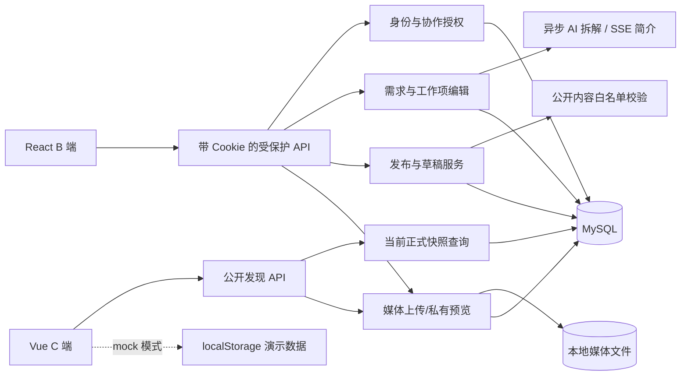
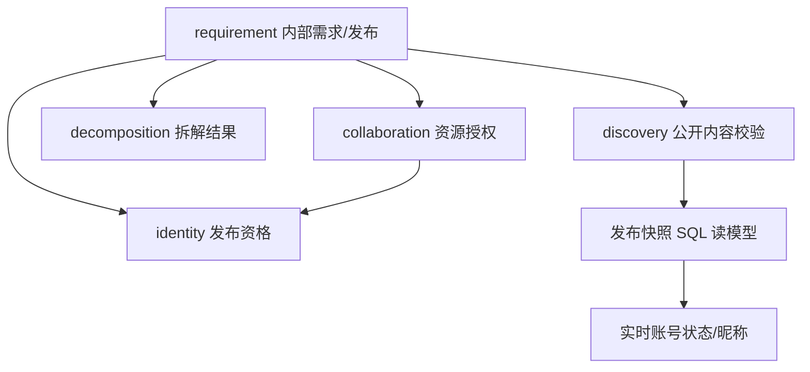
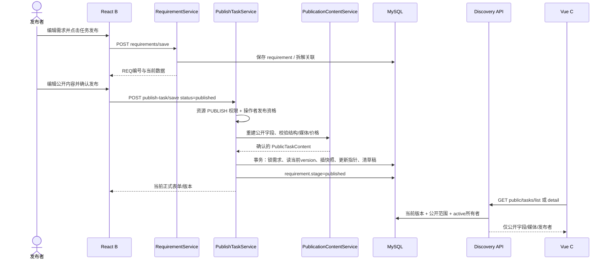
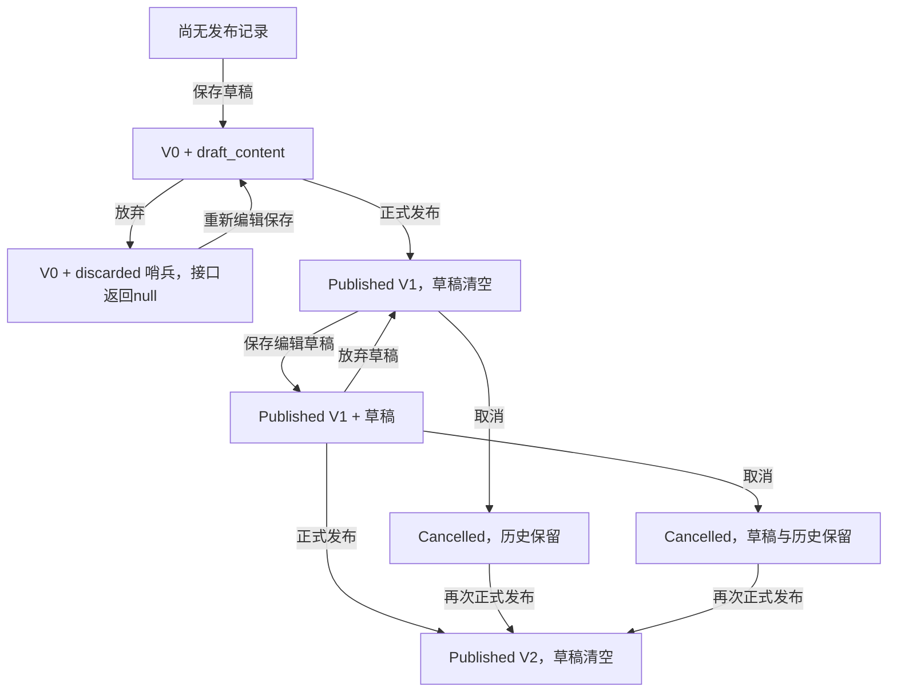
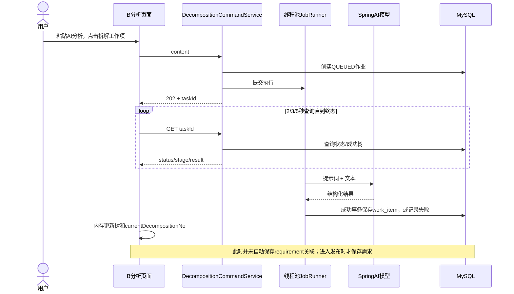

# 现有源码逆向理解与实现审查

审查日期：2026-10-25（Asia/Shanghai）。本报告只分析，不修改业务实现。报告中的建议不代表已经实施，也不自动转化为产品需求。

## 1. 执行摘要与审查覆盖范围

### 1.1 项目负责人先看这几项

1. **目前能形成真实持久化链路的是“B 端收集需求／AI 拆解／编辑工作项／确认发布 → C 端公开浏览”。不是完整的任务交易平台。** C 端默认真实模式下，收藏、意向、C 端发布、发布者选人均未接入真实业务接口；它们的完整交互只存在于本机演示服务。[B01/B07/B11、J11/J17/J22、C06/C07/C12]
2. **内部需求、编辑草稿、正式发布是三个不同层面。** 修改内部需求或保存发布草稿不会更新公众看到的正式快照；再次确认发布才新增版本。放弃草稿不是删除需求，取消发布也不删除历史。[J17/J18/J19/J23]
3. **“项目”和“任务”暂时不是两个独立业务实体。** 同一条正式发布通过 TASK 编号展示招募要求，通过派生 PROJECT 编号展示项目介绍与树；树中的工作项没有独立价格、名额、申请或承接状态。不能把展示树误认为多岗位接单系统。[J22.list/project/response、C05.adapt、C09]
4. **最紧急风险是开发认证未隔离。** 后端固定验证码、发送接口返回开发码，无环境开关；还存在配置中非空 API Key 默认值。它们在受控演示环境之外必须先处理。[J03/J04/J38]
5. **可用性有几个明确缺口：** 需求编辑主要留在内存、通常进入发布时才保存；无效 B 端需求地址会回落第一条需求；手动顶层工作项与公开树层级约束冲突；C 端关闭预览会重置分页。详见第 6 章。[B01/B07/B10、B08/J14/J20、C04]
6. **本次未完成现有手动服务的真实页面全链路验收。** 4173、5175 可访问，初次验证时 8080 无监听；C 页显示后端不可用，B 页显示登录。最终复查时后端已运行，公开接口可读，但 C 服务已停止，故仍未完成浏览器成功链路。隔离数据库测试与前端单元测试另行执行，不能替代真实浏览器的成功发布验证。详见第 9 章。

### 1.2 分析范围与事实级别

| 范围 | 本次处理 | 明确限制 |
|---|---|---|
| 当前 C 端 Vue 项目 | 路由、页面、真实 API 适配、演示服务、状态与交互 | 未实现的小程序/App 不在审查对象中 |
| 当前使用的旧目录 React B 端 | 需求、拆解、规划、发布、设置、账号与管理界面 | 不把另一个 Vue B 端目录的功能算到这里 |
| 共享 Java 后端 | Controller→应用服务→持久化、权限、迁移与测试 | 不读取或修改业务数据库数据 |
| 数据模型 | Flyway 与 Mapper 还原当前目标结构 | 未查询手动数据库的实际迁移历史；不保证本机已升级到源码最新结构 |
| 系统运行 | 两个现有前端的只读浏览器检查；隔离 MySQL 自动化测试 | 未发送真实短信；未调用真实大模型；未登录或修改手动服务业务数据 |

本文采用三种证据：**S=静态源码事实；T=本次执行的自动化测试；R=本次浏览器/进程实测**。静态上可确定的控制流不称“猜测”，但尚未复现的故障标为“静态风险”。“可能的业务预期”均为待确认项。代码由谁、基于什么讨论做出决策，不能从源码证明，因此本文不声称某一行为一定是 AI 擅自添加。

源码引用采用 `[Cxx/Bxx/Jxx/Txx]`，第 10 章给出每个编号的**完整绝对路径和函数依据**。这些是定位索引，不是外部资料。项目说明文档只用于了解操作约束，不作为实现完成的证据。

### 1.3 仓库边界

- C：`/Users/mainto/frontfile/freeligo`
- 当前 B：`/Users/mainto/Documents/Codex/2026-09-30/https-chatgpt-com-share-6abcced2-9a98/demand-workbench`
- 后端：`/Users/mainto/javafile/demand-workbench-backend`
- `/Users/mainto/frontfile/demand-workbench` 为另一个 B 端实现目录，本报告不评定其完成情况。

后端审查开始及结束时已有 `src/main/resources/application.yml` 未提交变化，本次保留；前端目录没有可用 Git 元数据，无法提供可靠提交号。报告反映读取时的磁盘源码。测试只产生构建输出/临时文件，本轮唯一新增的交付文件为本报告。

## 2. 系统整体架构

### 2.1 技术结构及其作用

| 层 | 当前实现 | 对业务的含义／取舍 | 依据 |
|---|---|---|---|
| C 页面 | Vue 3.5、TypeScript 5.9、Vue Router、Element Plus、Lucide、Vite 7 | 现为 Web 单页应用，不是 uni-app/uni-app-x；不存在已实现的跨端编译链路 | C/package.json、C01/C17 |
| C 状态 | Vue Query 管远端结果；Pinia 管演示身份；组件 ref/reactive 管偏好、弹窗、表单 | 筛选多在 URL，可刷新；近期浏览和偏好不持久化 | C03/C04/C07/C15 |
| B 页面 | React 19.3、React Router 7、Ant Design 6、Tailwind 4、TypeScript 6、Vite 8；历史 JSX 共存 | 新模块类型化，但核心 Analysis/Planning/PublishWizard 仍为 JSX | B/package.json、B01/B07/B08/B11 |
| B 状态 | TanStack Query + React 局部状态 | 需求列表又复制到 App 内存；树也由 App 内存持有，存在双份事实 | B01/B03/B09/B15 |
| HTTP | fetch、Cookie credentials、Zod 校验 | 响应不匹配会显式报错；B/C 各维护一份协议，不是共享类型包 | B23/C05 |
| 后端 | Java 21、Spring Boot 3.5.7、Spring Security、Validation、MyBatis、Flyway | 单体应用按业务模块分层，可在同一事务更新发布指针和快照 | J/pom.xml、J01/J17/J18 |
| AI | Spring AI 1.1.2、OpenAI 兼容客户端、资源文件提示词 | 拆解是后台线程任务；发布简介是 SSE 流，不是同一机制 | J11/J12/J13/J16 |
| 数据 | MySQL；关系表 + JSON 草稿/公开内容/编辑快照；逻辑删除 | 结构灵活，但公开 JSON、筛选列、原表列需保持一致 | J18/J19/J23/J30 |
| 文件 | 媒体元数据入库，文件交给 MediaStorage；当前本地实现 | 多实例/迁机需共享存储与备份；不具备转码平台能力 | J25/J26、后端 discovery/infrastructure 的存储实现 |

版本来自当前 package.json/pom.xml，未联网判断版本是否最新或是否含已知漏洞。

### 2.2 模块依赖与责任

后端 `identity` 负责账号、会话、业务身份、平台权限；`collaboration` 将需求成员权限继承到拆解/工作项；`requirement` 管内部需求、简介、发布任务及版本；`decomposition` 管 AI 作业和工作项；`discovery` 管共享分类、公开内容校验、公开查询和媒体；`background` 只提供登录背景。[J04/J06/J07/J09/J11/J17/J20/J21/J25/J29]

这不是完全隔离的领域模块：`PublishTaskData` 使用 discovery 的公开内容对象，`PublicationContentService` 反过来接收 `PublishTaskData`；application 中有 Spring 注解及 Reactor 类型。因此是实用分层单体，不宜描述为“严格无框架依赖的领域架构”。[J17/J20/J16]

### 2.3 数据对象必须分清

| 对象／表 | 记录什么 | 何时变化 | 关键约束与后果 |
|---|---|---|---|
| `requirement` | 原始标题、用户说明、AI 分析、当前拆解关联、阶段、所有者 | 保存内部需求、发布/取消、软删除 | 不是 C 端正文；删需求会使公开 join 失效 |
| `requirement_attachment` | 文件名、storageKey 等附件描述 | 保存需求时整批替换 | B 当前始终传空数组；UI 附件是硬编码 |
| `decomposition_record` | AI 输入、状态、阶段、模型/提示词版本、错误等 | 提交及执行作业 | 输入与工作项单独持久化，不等于已保存需求关联 |
| `work_item` | 四级树、角色、优先级、日期、依赖文本、状态 | AI 成功、人工编辑/删除 | 内部项目规划；不是独立公开招募记录 |
| `published_task` | 单需求发布身份、状态、当前版本号、可选编辑草稿 | 保存草稿、正式发布、取消、放弃 | `current_version=0` 表示无正式版；每个需求复用同一任务编号 |
| `task_publication_snapshot` | 公开 JSON、完整表单 JSON、筛选列、范围、人数、版本日期 | 每次正式发布插入 | 业务代码不覆盖历史；当前展示由任务指针选择 |
| `task_category` | B/C 共享稳定编码、名称、排序、启用、来源与创建人 | 迁移预置／登录用户新增 | 名称唯一；当前没有分类治理页面/API 完整链路 |
| `task_media` | 所有者、类型、MIME、大小、存储键、可空时长 | 上传 | 文件不在数据库中；是否可公开依当前发布引用判定 |
| `sys_user`、`user_auth_identity`、`user_session` | 账号、手机号身份、令牌哈希/失效时间/设备 | 注册登录、撤销、管理停用 | 原始令牌放 Cookie，不放数据库；每次认证查数据库 |
| `user_business_identity`、`publisher_profile`、`contractor_profile` | 发布人/承接人身份及等级成长 | 注册默认开通发布身份；主动开通承接身份；人工调整 | 发布资格、业务等级与平台管理角色分离 |
| `identity_credit`、`identity_ledger`、`identity_level_rule` | 信用、调整流水、升级规则 | 管理员调整/配置 | 成长可触发升级，信用不触发等级变化 |
| `sys_role`、`sys_role_permission`、`sys_user_role` | 平台角色与权限 | 迁移预置及管理员调整 | 不等于需求成员角色 |
| `requirement_member`、`account_audit`、`user_security_event` | 协作授权、管理审计、登录安全事件 | 加/移成员、账号/规则操作、登录/撤销会话 | 无真实 C 端意向/收藏表 |

依据：J10/J14/J18/J19/J24/J30/J31/J32/J33，以及后端 `src/main/resources/db/migration` 全部迁移。`public_task_profile` 只是早期迁移中的中间表，后续 J30 已删除，不能当成当前独立 C 端配置表。

**快照边界：** 内容和人数冻结，但发布者昵称、账号是否 active、分类名称以及媒体实际可读性仍由实时关联决定。历史版本记录并不意味着“永远可按当时原样完整还原文件与账号展示”。[J22.response、J23、J25]

## 3. 功能地图

### 3.1 C 端页面

| 入口 | 用户看见的功能 | 真实模式 | 演示模式 | 依据 |
|---|---|---|---|---|
| `/` | Hero、流程解释、分类、搜索、筛选、六条任务、预览、任务助手 | 分类/城市/列表读 API；收藏/发布按钮提示未接入 | 本机样例任务、演示登录与收藏 | C03/C05/C07 |
| `/opportunities` | 大厅、全部分类、任务/项目、筛选、分页、视图切换 | 每页 8 条 API 结果 | 本机结果分页，规则不同于真实 API | C04/C12 |
| `/tasks/:id` | 任务正文、报酬、媒体、范围/交付/验收、关联项目 | 真实读取；意向与收藏被拦截 | 可以模拟提交意向/收藏 | C09/C10/C11 |
| `/projects/:id` | 项目介绍、公开工作项树、回到招募要求 | 同一发布快照的另一视角 | 关联样例任务列表 | C05/C09 |
| `?preview=编号` | 桌面右侧预览 | 读取同一详情 API | 读取本机详情 | C08 |
| `/favorites` | 我的收藏 | 无真实登录/数据；仍有演示文案 | 按演示用户隔离收藏 | C04/C06/C12 |
| `/publish` | 三步填写、草稿、预览发布 | 页面可直达但保存/发布被拦截 | localStorage 草稿，生成一项目一任务 | C13 |
| `/publisher` | 我的发布、申请人、选人 | 无真实用户，不能进入真实管理 | 本机选人及名额控制 | C14/C12 |
| `/my-interests` | 我的意向 | 占位 | 同样占位 | C16 |
| 成果与成长、偏好、浏览记录、帮助 | 弹窗／本次首页记录 | 示例和内存交互，不读成长/履约后端 | 同上 | C02/C15 |
| 其他路径 | 页面不存在 | 占位兜底 | 占位兜底 | C01/C16 |

### 3.2 B 端页面与后台

| 入口 | 实际功能 | 完成边界 | 依据 |
|---|---|---|---|
| 未登录任意 B 页面 | 手机号验证码登录、每日背景 | 开发认证，非真实短信 | B04/J03/J04/J29 |
| `/requirements` | 搜索、创建、打开、删除需求、取消已发布任务 | 搜索为前端过滤；筛选/排序/视图等部分按钮无处理器 | B06 |
| `/requirements/:requirementId/analysis` | 编辑说明、生成可复制提示词、嵌入豆包、粘贴分析、AI 拆解 | 豆包为外部 iframe；真实结构化拆解调用后端，不自动抓取豆包对话 | B07/J11/J13 |
| `/requirements/:requirementId/planning` 与分析内嵌规划 | 工作项树、选择、增改删、甘特图 | 依赖为文本；无排程引擎；导入/筛选/排序部分为外观入口 | B08/J14 |
| `/requirements/:requirementId/publish` | 发布向导、分类新增、公开内容、媒体、预览、草稿/版本、放弃 | 发布真实持久化；预览与 C 的字段结构趋同，不是同一组件/像素布局 | B11–B17/J17–J26 |
| `/settings` | 昵称、账号、会话、安全记录、业务身份、等级、协作、管理 | 按平台权限显示操作；协作角色和平台角色分开 | B05/B18–B22/J05–J07 |
| 侧栏其他模块 | 提示后续开放 | 无独立业务模块 | B01.navigateSidebar |

B 的根路由 `/` 跳 `/requirements`，其他地址都先交给 App 解析，不是逐条声明的严格页面路由。[B02/B01]

## 4. 各功能详细实现分析

### 4.1 登录、账号资料与登录安全

**目的／入口：** B 端受保护应用之前登录；设置页改昵称、看账号及撤销设备。C 当前并未复用这套认证 UI。[B04/B05/C07]

**用户与状态流程：** AuthGate 查询 `users/me`；无用户展示登录表单。先发码再提交登录，成功后清理其他业务 Query 缓存、重新获取当前用户；退出时撤销服务器当前会话并清缓存。资料保存更新 current-user 缓存。设备列表以服务器对令牌哈希的比较标记“当前设备”，不能通过撤销其他设备接口撤销当前会话。[B04/B22/J05]

**接口与持久化：**

| 请求 | 处理／返回 | 数据变化 |
|---|---|---|
| `POST /api/v1/auth/sms/send` `{phone}` | 只在进程 Map 存 5 分钟有效期；返回开发码 | 不调用短信商，不落验证码表 |
| `POST /api/v1/auth/sms/login` `{phone,code}` | 固定 `123456`，验证一次性消费；账号非 active 拒绝 | 首次写用户、手机身份、发布人身份/L1资料、member角色；写会话、最后登录与安全事件 |
| `GET /api/v1/users/me` | 当前用户、手机号、发布等级等 | 读用户资料 |
| `POST /api/v1/users/profile/save` `{nickname}` | 更新昵称、返回当前资料 | 更新用户记录 |
| `GET /api/v1/users/sessions`、`security-events`、`publisher-eligibility` | 有效设备／最近事件／是否可正式发布 | 查询当前用户数据 |
| `POST /api/v1/users/sessions/revoke?sessionNo=...`／`revoke-others` | 服务器限定当前用户；禁止撤销自己这一条 | 更新 revoked_at、写安全事件 |
| `POST /api/v1/auth/logout` | 清 Cookie，撤销令牌 | 撤销当前会话 |

依据：B22/J03/J04/J05/J32；用户资料实现见后端 `identity/application/UserProfileService.java` 的 `find/save` 及 `identity/controller/UserController.java` 的 `me/save`。

**规则／异常：** 手机格式 `^1\d{10}$`；默认会话 30 天、SHA-256 令牌哈希、HttpOnly+SameSite=Lax Cookie；未设置 Secure。服务端过滤器对每次请求认证，不是 JWT。固定验证码与进程内 Map 不支持可靠多实例；发码无速率限制；重复或过期码拒绝，停用账号撤销会话。接口认证由 SecurityConfig 白名单控制，Controller 中默认 userId=1 的兼容分支在当前受保护路由下不应被正常匿名 HTTP 使用，不能因此直接断言匿名可越权。[J01–J05/J32]

**状态及证据：** S：存在完整 B 端实现；T：Auth/AccountSecurity/Controller/Persistence 测试；R：本次 B 登录页可渲染，因后端关闭未执行发码/登录。**真实短信、生产认证强度未验证且从源码看未实现。**

### 4.2 账号身份、等级成长与平台管理

**目的／入口：** 设置页区分“我是发布人/承接人”和“我能否管理平台”，管理员可调整角色、账号状态、成长规则与积分信用。页面由 AccountCenter/AdminPanel 和 accountApi 驱动。[B19/B20/B21]

**实际规则：** 新账号自动发布人 L1，承接身份主动开通 J1；重复开通不重置等级，受限身份不允许借此恢复。正式发布资格是手机验证+发布身份/资料 active+等级在 L1–L5，而非必须达到某个高等级；业务升级不授予 admin 权限。[J06.activateContractor/J37/J32]

| 操作/接口 | 服务与数据库行为 | 边界 |
|---|---|---|
| `GET users/identities`、`users/level-rules` | 读身份、权限、最近流水和规则 | 平台角色与两类身份各自独立 |
| `POST users/contractor/activate` | 新增承接身份/资料并审计 | 当前手机已验证、账号 active |
| `GET admin/users`、`admin/audits` | 按管理权限查询 | 只取最近 100，非完整分页管理系统 |
| `POST admin/users/role/save` | 替换角色，审计 | 不可剥夺最后一个正常管理员 |
| `POST admin/users/status/save` | 改状态，非 active 撤销全部会话，审计 | 不可停用自己或最后管理员；不支持实际注销流程 |
| `POST admin/identities/adjust` | eventNo 幂等；成长/信用流水并审计 | delta 非零且 ±100 万内；成长不能负；信用独立 |
| `POST admin/level-rules/save` | 乐观版本更新规则 | 基础等级不可改；启用门槛非空且严格递增 |

路径前缀均为 `/api/v1/`；请求通过 B21 构造，完整约束在 J06 与 `AccountPlatformController`。成长扣减不降级，只向高于当前顺序的达标等级升级；规则修改不会自行批量重新计算所有用户。管理写入以管理员角色行锁串行保护，简单但会把不同账号的敏感操作串行化。[J06.record/saveRule、J33]

**失败与验证：** 无权限返回领域错误；重复 eventNo 内容不一致冲突；并发规则版本不符拒绝；未找到目标账号拒绝。T 为服务/Controller/真实 MySQL 管理集成测试，R 未进入登录后的管理界面。没有任务完成事件自动计分、支付信用或真实 C 端成长记录接入。[J06/B19/C02]

### 4.3 需求收集、保存、列表与删除

**业务流程：** 列表“新建需求”先在 App 创建 `LOCAL-时间戳`，不是立刻写数据库。分析页的标题、原始说明和 AI 说明编辑保存在组件/App 状态；点击“任务发布”进入 `openPublishing`，才调用保存 API、换成 REQ 正式编号，再进入发布向导。[B01/B07/B10]

**前后端链路：** `POST /requirements/save?requirementNo=...` 请求含 title、userDescription、aiDescription、stage、currentDecompositionNo、attachments；B 固定传 `stage:'draft'`、`attachments:[]`。后端新建生成基于标题缩写+数据库 ID 的稳定需求号；更新不重生成编号；已发布/已取消需求保存内部内容时保留原阶段。关联拆解必须存在、当前用户有权访问且成功完成。[B10/J08/J09/J10]

- `GET /requirements/list` 返回本人需求，加上协作共享需求；本人列表与共享追加不是统一 SQL 全局排序。每条转换还查附件，形成列表 N+1。[J09.list/J10.toData]
- 搜索按标题包含或编号小写包含在浏览器过滤，不是服务器搜索/分页。列表全部载入。[B06]
- `POST /requirements/delete?requirementNo=...` 仅所有者可软删除，不级联删除拆解/文件/快照；公开查询因 requirement.deleted 过滤而隐藏任务。[J09.delete/J10.softDelete/J23]
- 需求收集附件 UI 显示固定两个文件名，添加/删除按钮无真实实现；保存会把附件描述整批替换为空。不能把它和发布媒体上传混为一谈。[B07 附件模板、B10/J10.replaceAttachments]

**边界／负责人应理解：** 刷新可能丢失未保存需求与其关联；AI 拆解结果可能已在数据库，但当前需求尚未保存其关联。空原始说明会在分析页回落到预约系统示例文本，可能造成“我没有写但页面有内容”的误解。无效 requirementId 回落第一条需求而非不存在页，存在操作错对象风险。[B01.requirement/createRequirement/openPublishing、B07.initialDescription]

**状态及证据：** S 完整读写路径可追踪；T RequirementService/Controller/编号/迁移用例；R 未在手动系统登录后操作。独立“保存需求”/离页保护在当前分析页链路中缺失，不把发布草稿按钮算作保存原始需求。

### 4.4 AI 辅助分析与结构化拆解

**页面入口与真实分工：** “生成需求拆解提示词”只是拼文本并复制；豆包 iframe 是外部网页，需要用户自行交流并粘贴分析文本；“拆解工作项”才是系统自己的后台 AI 调用，输入为 `aiDescription.trim()`。[B07.openPrompt/startDecomposition/J11/J13]

**执行规则：** `POST /requirements/decompose` `{content}`，非空且最多 50,000 字符，返回 HTTP 202、任务编号与 queued；B Query 每 2/3/5 秒轮询 `GET /requirements/decompose?taskId=...`，SUCCESS/FAILED 停止。后端先插入作业，再投专用线程池；队列提交失败标记失败并报服务不可用。[B09/J11、后端 decomposition/controller/request/DecomposeRequest.java]

**生成与数据库：** JobRunner 更新 generating→validating→saving；SpringAiWorkItemGenerator 从资源提示词生成对象，将层级固定解释为 module→feature→work→subtask，重建 ID，设初始“未开始/未分配”，日期为空；超过四级、空名称和非法优先级等失败。成功事务保存树，并更新作业为 success；失败持久化稳定错误码/说明。当前生成器返回 rawResponse/promptTokens/completionTokens 为 null，不能把表上有列理解为已采集成本。[J12/J13/J14]

**前端变化：** 成功结果写 App 的树与 currentDecompositionNo；这不是保存 requirement 的网络请求。重新拆解生成新 DEC，而非新增原发布快照。旧正式公开内容不随内部树变化。[B07 effect/B01/J17/J23]

**异常／取舍：** 重启时将所有 queued/processing 作业标失败，不恢复执行；单实例直观，但多实例启动会影响其他实例正在运行的作业。无持久消息队列、作业所有权租约、取消和幂等提交；相同输入可以重复计费/生成。iframe 是否被外站策略禁止嵌入、第三方登录状态和真实大模型质量未在本轮验证。[J15/J11/B07]

**状态及证据：** T JobRunner/Query/Controller/WorkItem 等测试验证作业和解析边界，非真实大模型端到端验收；S 后台流程已实现。

### 4.5 工作项树编辑与甘特图

**用户流程：** 树展开、勾选工作/子任务、点击行或编辑抽屉、修改状态/角色/优先级/日期，保存后请求返回节点替换局部树；删除弹窗确认后服务器递归软删除，前端移除对应分支。[B08]

**接口／数据库：** `POST /api/v1/work-items/save`传 decompositionNo、可选 workItemNo/parentWorkItemNo、type/name/description/status/role/priority/date/dependency；服务检查 EDIT 权限，Repository 校验同拆解父节点和子类型相邻。已有工作项只更新可编辑属性，不移动父级或改变类型；新增生成 MANUAL 编号。`POST /work-items/delete` 按编号批量授权、去重并删除后代；事务保证权限失败不部分写入。[J14/J35、后端 decomposition/application/WorkItemCommandService.java、decomposition/controller/WorkItemController.java]

**实际而非想象的规则：**

- 仅工作/子任务参与一般勾选，但模块/功能可编辑及添加下一级。顶栏“新增工作项”默认直接新建 root work；后端允许没有父节点的任意合法 type。这与公开树固定层级冲突。[B08.openCreate/saveEditing、J14.saveWorkItem、J20.validateTasks]
- 状态是受长度限制的字符串，不是服务端严格状态机；没有验收人/审批/回退限制。工作项日期未检查起始≤结束，公开项目发布时才检查。[J35/J14.apply/J20]
- “前置依赖”保存为文本，UI 选项中存在硬编码“服务项目列表/门店列表”；没有真实外键、循环依赖检测或自动排程。[B08.WorkItemEditorDrawer/J14]
- 甘特图只画有起止日期的节点，点击仍打开编辑；不支持拖动排程或依赖联动，不能称为完整项目管理引擎。[B08.Gantt]
- 独立 planning 地址刷新时，App 树为空；不像 analysis/publish，它本身不查询拆解树，可能显示空树。属于静态路由刷新风险。[B01/B08/B09]

**实现状态／验证：** S/T 有真实增改删与集成基础；未在本次浏览器登录后验证整棵树、异常日期及独立地址刷新。无 decompositionNo 时手动新增也会被 UI 拒绝，不能完全跳过拆解创建纯手工项目。[B08.saveEditing]

### 4.6 发布简介生成

**目的：** 发布向导自动获得可编辑的任务简介，减少重复填写。[B11/B17]

**调用链：** 先 GET `/requirements/publish-summary?requirementNo=...`，已有 content 直接用；无内容时 POST `/requirements/publish-summary/generate?requirementNo=...`，消费 `content/complete/error` SSE 事件。后端去除 AI 分析里从“可选”或“技术风险”标题开始的后续内容；无 AI 分析则直接复制用户原始说明，否则调用模型；完成后把简介与状态、提示词版本、生成时间存 requirement。[J08.generatePublishSummary/J16、B17]

**特殊规则：** 有已保存 content 就不再生成，即使原始说明更新；不是“始终与需求同步”。正则截取是规则判断而非语义识别，标题后若还有必需内容也会被截掉。界面 summaryTouched 防自动结果覆盖手工摘要。客户端断开后只停止向浏览器发事件，没有对应取消模型订阅的完整生命周期；多窗口可同时发起请求，无需求级生成锁。[J16.generate/extractConfirmedAnalysis、J08、B11/B17]

**状态及证据：** S/T：服务单测覆盖已有内容、生成与直接复制路径；真实 SSE 网络长连接、异常断流与并发模型调用本次未验证。已有简介复用、正则截断是否符合产品意图需确认。

### 4.7 共享技能分类与城市

**目的／入口：** B 发布时选/新增分类；C 首页前六类、大厅全部分类、城市筛选。[B11/B24/C03/C04]

- `GET /public/task-categories` 返回启用且未软删的 `{code,name,sortOrder,enabled}`，按排序值/编码；不是按名字临时拼出来的 C 配置。
- `POST /task-categories/create` `{name}` 需登录；NFKC、strip、压缩空白，最长 64、禁控制字符；生成 cat_UUID 稳定编码、排序 1000、记录 actor，数据库名称唯一，同名复用。新建直接进入共享字典，不是“我的私有分类”。没有审核/合并/编辑/启停界面完整能力。[J21/J24/J30]
- 停用分类不能用于新的正式发布，旧公开任务仍可按 code 查询并展示历史/当前名称；分类列表不显示该停用项。[J20/J21/J24]
- `GET /public/task-cities` 是**当前公开现场/混合任务实际出现的城市集合**，不是行政区划库；同编码取 MAX(cityName)，所以错误城市名可能影响显示。[J23.cities]
- B 城市码与名称由发布字段提供；服务端只要求六位数字与非空名称，不能证明“码和名真实匹配”。远程任务不会出现在城市筛选结果中，混合任务会。[J20/J23]

**异常／证据：** 重复名称复用或停用同名拒绝；查询失败页面有分类重试；首页城市查询错误缺少独立同等明显的反馈。S/T：共享分类、规范化同名、真实城市选项集成验证；R：初次浏览器检查后端不可用，分类错误与重试入口显示；末尾追加GET验证时分类接口已恢复200，见9.3。

### 4.8 发布内容、项目树与 B/C 预览

**用户流程：** 保存原始需求后进入三步发布向导，补充标题/分类/简介、技能/经验、人数、报酬、时间、工作方式、城市、媒体、范围/交付/验收、新人标记，编辑公开项目介绍，预览后确认发布。[B11/B24]

**数据来源规则：** `publicationContent` 同时给预览和保存请求构造公开对象；后端 `prepare` 又以原表单 title/summary/category/skills/dates/workMode/budget 为准重建公开字段，避免双份冲突。金额类型、数值和单位来自结构化公开内容，不解析自由预算文本来猜价。[B12/J20]

**项目树：** `buildPublicProject` 只复制选中节点及必要祖先的 name/description/role/date/children，公开 ID 按位置生成，不包含内部编号、状态、优先级、依赖、附件。已有 `content.project` 后不会随内部树自动变动；用户点“从当前已选工作项更新”显式重建。注意自动复制的 description/role 仍须由发布者确认无敏感内容，白名单不等于隐私脱敏。[B12/B14]

**服务端发布校验：**

| 字段 | 实际约束 | 空值规则 |
|---|---|---|
| 标题/简介 | 发布非空；最长 255/5000 | 草稿可空 |
| 分类 | 必须共享字典且 enabled | 草稿可暂留未完成值 |
| 人数/来源 | 正式发布至少 1；需求已有 currentDecompositionNo；需 PUBLISH 权限及发布资格 | 不能直接发布无拆解关联需求 |
| 工作方式 | B 为远程/现场/混合，映射 remote/onsite/hybrid | 非远程必须城市六位码和名称 |
| 报酬 | fixed/range/negotiable/non_cash；CNY；project/hour/day/time/item | fixed上下相等；range上下有效且有序；面议/非现金不得留金额，非现金说明必填 |
| 数值 | 非负、最多两位小数、上限 9999999999.99；effort>0 | effort 无值不展示；有值需 hour/day |
| 时间 | startDate 不晚于 deadline；项目节点 start 不晚于 end | 两端均可未填 |
| 技能／范围／交付／验收 | 技能≤20；其他各≤30，行长度受限 | 可为空数组，空章节隐藏 |
| 媒体 | ≤8，编号不重复；归当前操作者或需求所有者；封面只能图片 | 有附件媒体时必须图片封面；无素材可纯文本 |
| 公开项目树 | 唯一 ID、≤500 节点、层级固定四级、节点名非空 | project 可空；项目标题/简介可空字符串，任务树可空 |

依据 J17/J20/J36，前端映射 B12。草稿也做 shape 校验，不是可以保存任意坏 JSON；发布才增加语义/媒体权属强校验。后端不会根据内部树重新核对公开项目树真实性，只校验结构与字段，授权发布者可提交自行编写的树。[J20]

**预览一致性的真实程度：** B 用 React PublicTaskPreview，C 用 Vue TaskBody；共享的是快照字段含义与章节，未共享渲染组件。B 有“发布后所有人可见”提示和私有上传预览，C 有实时发布者与发布时间和详情操作。两端字体、留白、媒体加载、空值格式仍可不同；不能承诺像素一致。封面同时在媒体列表时，两边都有重复展示可能。[B13/C10]

**证据：** S：统一映射/校验；T：B publicationPreviewModel 单测和 J 集成测试；R：本轮未验证成功数据预览。合作编辑者能引用所有者媒体，但 B 私有元数据/内容仅上传者可读，可能出现合法发布内容在 B 预览失败，详见第 6 章。[J20.validateMedia/J25.read/B13]

### 4.9 发布草稿、正式版本、取消与放弃草稿

**入口：** 发布向导的保存草稿、放弃草稿、确认发布和历史；需求列表取消。[B06/B11/B15/B16]

| 操作 | 数据库变化 | C 端影响 | 依据 |
|---|---|---|---|
| 首次保存草稿 | 创建稳定 TASK 记录，draft_content 保存完整表单，current_version=0 | 不展示 | J18.save/J19.draft |
| 已发布后保存草稿 | 只更新 draft_content，不替换正式快照、状态与指针 | 仍显示旧正式版 | J17.save/J18 |
| 确认发布/再次发布 | 锁需求行；读数据库当前版本+1；写任务正式列、插快照、更新 current_version、清草稿；需求阶段 published | 新请求读新正式版 | J17/J18/J19 |
| 放弃草稿，有正式版 | 清 draft_content，返回当前正式表单；UI 显式恢复本地副本 | 正式内容不变 | J18.discardDraft/B11.discardDraft |
| 放弃草稿，从未发布 | 写 discarded 哨兵，读取返回 null，保留 TASK 唯一身份 | 仍无公开内容 | J18.findByRequirementNo/J19.discardDraft |
| 取消发布 | 任务/需求 cancelled，保留草稿及历史 | 公开列表/详情不再可见 | J17.cancel/J19.cancel/J23 |
| 历史查看 | READ 授权后按 version 读 editor_content；不存在返回未找到 | 历史并非匿名公共接口 | J17.version/J18.version/B16 |

**并发：** 用户提交的 version 不是拒绝覆盖的条件；单需求行锁确保版本递增，后提交者覆盖前提交者的最新内容。即使两个窗口都基于 V1，仍可能依次成为 V2/V3，V3 含旧视图内容。这是现有策略，不应误报为“缺少乐观锁导致版本号重复”，但需要承认内容丢更新风险。[J18.save/J19.lockRequirement]

**范围规则：** 新保存统一“所有人可见”+空 audience，前端不可编辑可见范围；旧受邀范围快照保留授权保护，不会自动对匿名开放。公开详情对旧受限数据可按所有者/受邀账号读取，协作成员身份本身不等于受邀资格。[J17.save/J23.accessible]

**边界：** 取消后仍可经再次正式发布回到 published；列表提示“不能直接恢复”应理解为无恢复按钮，而非永久不能再发布。未发布草稿没有版本历史，历史仅从正式发布开始。取消不会新增取消事件版本。首次发布时间用于排序，当前快照时间用于响应，二者不同。[B06/J17/J19/J23]

**证据：** T：T01 的草稿隔离、历史不可变、放弃首草稿后再发布、项目冻结、取消保留历史等；T02 迁移。S：所有流程；R：本轮未成功浏览器发布。

### 4.10 C 端发现、筛选与分页

**用户目标：** 找到仍在公开招募的任务；非登录用户可浏览。首页最多 6 条，大厅每页 8 条；“查看更多”进入大厅，不是原地无限加载。[C03/C04/C05]

**URL→查询：** 搜索/分类/城市/工作方式/预算/新人/类型/排序存 route.query；Query key 随条件变化。真实 API 请求 `GET /public/tasks/list` 或 `projects/list`，返回 `{items,total,page,pageSize}`；Zod 校验包裹 `success/msg` 后映射 Opportunity。[C05.browse/requestPublic/adapt]

| 条件 | 当前真实规则 | 易误解点 |
|---|---|---|
| 关键词 | SQL LOCATE 搜任务标题/简介/技能、项目标题/简介 | 不搜每个项目树节点；无全文检索/语义匹配 |
| 分类 | categoryCode 精确匹配 | 分类名称不是稳定主键 |
| 城市 | cityCode 精确匹配且 mode 为现场/混合 | 远程不会匹配所选城市 |
| 工作方式 | remote/onsite/hybrid 精确 | 远程不是“所有方式” |
| 新人 | newcomer=true 才筛 | 发布者勾选，不是系统能力评估 |
| 预算 | 同计价单位、fixed/range，区间相交 | 不是任务价格完全落入筛选区间；面议/非现金被排除 |
| 首页预算段 | ≤999.99、1000–3000、≥3000.01 | 999.99/1000 与 3000/3000.01 边界由前端生成 |
| 为你发现/最新 | 相同 SQL 排序：首次正式发布降序，再按 TASK 编号降序 | 没有个性化；重发新版本未必置顶 |
| 身边机会 | 要求先手动选城市 | 没有定位、距离或额外就近排序 |
| 类型 project | 同一份正式记录，映射为项目视角 | 不是额外查询多岗位项目表 |

服务校验 page 1–10000、pageSize 1–100、keyword≤100、金额精度与上下界等；list 与 count 使用相同条件及 REPEATABLE_READ，保证一次请求内总数与结果对应。不同翻页请求不是同一快照，大量新发布仍可能造成偏移分页重复/跳项。[J21/J23/C05]

**可见性：** 必须任务 published、当前正式版本、需求未删、所有者未删且 active、快照未删、所有人可见。列表不将协作私有任务掺进公共列表。deadline 到期不会自动隐藏，所有者业务身份/等级并未在公共 SQL 中重新检查，只有账号 active 检查。[J23.publicWhere]

**异常／状态：** 加载 skeleton、错误+重试、空结果+清筛选；接口结构不匹配显示错误，不回落假数据。切换排序保留筛选；视图只改 CSS/本地状态，不改结果。大厅页码在 ref 中，route.query 任意变化会设回 1，因此预览 query 的开关也会重置分页，这是风险而非预期的“保留位置”。[C03/C04/C05]

**证据：** S/T01/T03；R 初次首页有明确错误提示，列表视图 aria-pressed 实测切到 true，不能证明成功任务列表交互。

### 4.11 任务预览、独立详情与项目查看

**流程：** 首页/大厅卡片点击，桌面以 `?preview=编号` 打开抽屉，窄屏进入详情路由；收藏按钮单独发事件。预览可看完整详情；任务可去项目，项目可回同一招募要求。[C03/C04/C08/C09/C18/C19]

**接口与状态：** 预览/详情共用 Query key `['opportunity',id]`、`service.detail`；TASK 走 taskNo 参数，PROJECT 前缀走 projectNo；后端映射回 TASK 读取同一个 current_version。返回公开字段、实时发布者、人数、分类名、媒体 URL；不返内部 requirementNo、原始 AI 分析或编辑表单。注意公开 project 是主动发布的白名单树，而不是实时内部树。[C05/J22/J23]

**展示：** 数字报酬带 ¥/单位；面议与非现金不伪造金额；纯文本可无封面；空范围/交付/验收/投入字段隐藏；资料可放大图、HTML video 播放；项目树折叠展开；API 任务状态统一映射为 open，因为后端只返回可公开招募内容。[C05/C10]

**边界：** 下架/私有/已删统一查不到，不区分精确原因；已打开浏览器缓存可能短暂显示旧内容。当前读不到取消后的“结束详情页”。返回链接硬编码去大厅，没有保存来源筛选与页码；完整详情 queryFn 未传 AbortSignal，即使服务支持 signal，切换详情后旧请求未主动取消。[J21.detail/J23、C09/C08/C05]

**状态及验证：** S/T01/T03；R 本次没有可用后端任务，所以未验证真实数据详情、图片/视频和项目切换；不引用历史会话截图当成本次通过证据。

### 4.12 图片与视频基础能力

**目的：** 发布者上传参考素材，让公众在任务卡和详情中判断；不是短视频内容平台。[B24/J25]

**完整链路：** `POST /task-media/upload` multipart file → Controller 取 bytes → MIME 字节签名判断（JPEG/PNG/WebP/部分 MP4 brand）→ 文件保存 → `task_media` 写元数据 → 返回 mediaNo/type/contentType/size/durationSeconds/previewUrl。数据库写入失败时删除刚存文件。公开后内容按当前可见任务引用授权，不是拿到任意 mediaNo 都能匿名访问。[J25.upload/read/mime/J26/J23.mediaAccessible]

- `GET /task-media/metadata`、`/task-media/content` 限上传者，用于 B 草稿预览；`GET /public/task-media/content` 允许当前公开引用或旧受限范围授权读取。媒体返回资源、nosniff/no-store，并由 HTTP 资源处理支持 Range。[J25/J26]
- 业务大小上限 50MB；整个 MultipartFile 进入内存，未流式安全解码、校验图像像素、去 EXIF、扫描、视频转码、自动封面或时长提取。durationSeconds 上传时为 null，不能虚构展示时长。[J25]
- 视频需另给图片封面；详情能播放不意味着编码对所有浏览器兼容。签名合法不保证完整可解码或没有危险/损坏内容。[J20/J25]
- 取消/删除/换版本导致不再有当前公开引用时，原公共文件链接可能失效；历史快照保留媒体编号但没有独立“历史版本媒体可读”授权。[J23/J25]
- 未引用的上传文件不会在放弃草稿时自动删除，需后续保留策略。没有把媒体生命周期事务与文件系统完全统一。[J18/J25]

**状态及证据：** S 具备基础功能；本次现有集成测试并不等于真实浏览器多格式/Range/大文件安全验收。未做视频兼容矩阵、损坏媒体、并发上传内存压力测试。

### 4.13 收藏、承接意向、发布者选人：真实模式与原型必须分开

**真实模式：** C07.requireLogin 总是显示后续接入提示，不读取 B Cookie 当前用户来建立 C 登录；C06.favorite/submit/publish/accept 均 unavailable，owned/applicants 返回空；后端本次模块中不存在承接意向/收藏业务 Controller、Service、持久化表。不能因界面有“提交意向”就判断服务已打通。[C06/C07、后端源码/迁移枚举]

**演示流程：** sessionStorage 保存两个固定演示身份；localStorage `freeligo.prototype.v1` 保存任务、收藏、申请，刷新 seed 时保留部分本机状态。收藏按 user.id 隔离、再次点击取消；submit 只能申请开放 task，不能申请自己发布的，不能重复；经验与开始时间必填，作品 URL 在表单做 http(s) 检查；成功 pending，不直接接单。发布者查看申请并选择，名额满自动关闭 task，已选操作幂等，没有拒绝/撤回/修改/重投/撤销选择。[C07/C11/C12/C14]

**数据库与 API：** 演示所有上述操作只走 JS service、180ms 模拟延迟和 localStorage，不发后端业务请求；浏览器清数据、换设备、用户直接改存储都影响结果。这不是认证、权限或可靠并发控制。[C12]

**边界：** 满额关闭的是 task，关联演示 project 不随之关闭；模拟发布一次复制内容生成一个 project+一个 task，不能类比真实快照设计。`hasInterest` 只按存在判断，暂没有完整意向生命周期。“我的意向”一直是占位，不提供已提交列表。[C12/C16]

**验证：** T04 演示服务六项边界用例本次通过；R 点击首页发布需求实测显示后续接入提示且未导航。模拟能力未当作真实功能验收。

### 4.14 C 发布、辅助模块及登录背景

**C 发布原型：** 三步填写；标题/说明、工作范围/交付要求必填；非远程必须城市；草稿按演示用户键保存 localStorage；路由离开有未保存确认；提交默认周期/报价可为协商文案。类别是硬编码演示列表，与真实共享字典并未统一到这张未接入页面；直达 `/publish` 也不能绕过真实模式拦截。模拟发布生成两条本机对象，不调用 B 发布接口。[C13/C06/C07/C12]

**任务助手：** 偏好只是 ref 中四个勾选，不影响推荐；最近看过只记录当前首页打开的最多 8 条，显示前 2 条，刷新清空，不覆盖所有页面；帮助弹窗说明意向非承接成功。没有偏好 API、浏览历史表或真实个人助理算法。[C03.open/C15]

**成果与成长：** 静态招牌前后样例弹窗，明确写未接入个人成果与成长；B 的等级管理并未连到此 C 内容。[C02/B19]

**登录背景：** 后端固定 Bing HTTPS 域名取当天图片，成功缓存一小时；刷新失败可用旧缓存并延后五分钟；首次取失败仍会异常，B 页面提供自身背景降级处理。该模块不写数据库。[J29、B 的 features/auth/components/LoginBackground.tsx]

**证据：** S；R 偏好弹窗能打开/完成、首页布局存在；不将静态图片样例算作真实完成成果。

## 5. 关键业务流程和数据流

### 5.1 从内部需求到公众看到正式内容

依据 B01.openPublishing/B11.taskPayload/B12.publicationContent、J09/J17/J18/J20/J22/J23。两个保存请求分开，**整个“保存原始需求→确认发布”不是一个跨请求原子事务**；发布失败时原始需求保存可已成功。

### 5.2 草稿与正式状态不是一个简单状态字段

图中的 V1/V2 为示例，实际按数据库当前版本递增。放弃 cancelled 状态草稿恢复的是原正式表单+cancelled 状态，不自动恢复公开。[J17/J18/J19]

### 5.3 拆解作业及保存边界

依据 B07/B09/B10/J11–J15。进程重启后未完成作业直接失败，不是继续轮询等待重新执行。

### 5.4 权限的四层含义

| 判断 | 何处执行 | 不能替代什么 |
|---|---|---|
| 是否登录、账号正常 | Cookie 过滤器/AuthService | 不代表可修改任何需求 |
| 需求成员角色 | CollaborationService：viewer读、editor编辑、manager发布/管低级成员、owner删除 | 不能由高业务等级绕过 |
| 发布资格 | AccountSecurityService + PublisherEligibility | 管理员/协作管理员仍需自己的发布资格 |
| 公众可见范围 | 当前快照与 Discovery SQL | 所有者可编辑不意味着旧私有任务对公众开放 |

在 `PublishTaskService.save` 中操作权限判断用 actor，资源归属仍是 requirement.owner；公开“发布者”显示 requirement.owner，不是最近操作发布的协作管理员。这是需要产品确认的展示规则。[J17/J07/J23]

## 6. 技术设计审查

优先级：**P0** 对外使用前必须处理的高危边界；**P1** 核心数据/业务正确性；**P2** 稳定性、治理或增长后风险；**P3** 展示/维护改进。以下均是发现或建议，未在本轮修复。

| 编号/级别 | 源码证据与实际行为 | 影响与触发 | 建议与证据强度 |
|---|---|---|---|
| F01 P0 | J03.sendCode 返回开发码；J04 固定码，无 profile 开关/限频 | 部署到不受控环境后，能为他人号码发码并登录，手机号验证失去意义；Map 可被批量填充 | 接真实短信、随机哈希码、发送/尝试限速与审计；开发认证在生产硬拒绝。S，未对实际用户执行 |
| F02 P0 | J38 的 API Key 配置有非空环境变量默认值 | 源码/配置分发可泄露服务凭据；不能确认该值是否有效或已外泄 | 去除秘密默认值、环境注入、评估轮换及历史清理；不在报告复制其值。S |
| F03 P1 | B07 编辑只更新 React；B01.openPublishing 才调用 B10.saveRequirement | 编辑后刷新/返回，原始需求和拆解关联可能丢失；AI 作业却已持久化 | 明确保存需求入口/保存状态，离页保护，或定义可恢复自动草稿；不能只加发布草稿按钮。S |
| F04 P1 | B01.requirement = find(id) ?? requirements[0]；B02 通配路由 | 错误/无权限/已删除编号可能显示并操作第一条真实需求 | 区分加载、无权限、404；不按第一条兜底。S |
| F05 P1 | B08.openCreate('work') 无 parent；J14.saveWorkItem 接受 root work；J20.validateTasks 顶层只 module | 手动新增成功但发布校验失败，用户在编辑时得不到约束提示 | 统一内部/公开树合法结构；选择“必须模块根”或显式包裹转换并测试。S，未本次实测 |
| F06 P1 | J35 日期无顺序校验、status任意受限长度字符串；J14.apply 直接保存；J20 发布才查日期 | 内部树可出现反向时间/未知状态，甘特异常或发布迟发错误 | 把核心不变量放应用/领域层，字段错误映射给表单；允许状态集合需产品确认。S |
| F07 P1 | J20 接受 actor或owner媒体；J25.read 私有只 uploader；B13 查询私有媒体 | 协作者合法使用所有者媒体时 B 预览失败，C 正式公开后可能正常 | 增加按需求READ范围的草稿预览授权，或明确仅上传者编辑；不能直接开放所有私有媒体。S |
| F08 P1 | C04 route.query watcher 无差别 page=1；open/close 修改 preview | 第二页打开/关闭抽屉会回第一页；与保留浏览上下文预期冲突 | 只对真正筛选条件重置页；页码进入URL，关闭预览保持结果。S |
| F09 P1 | B01 把 Query需求复制到本地；B07 useState(requirement...) 无同步重置，渲染无 key；B09 初始taskId仅初始化 | 同组件切换需求或 Query 更新时，局部文本/拆解与当前需求可能不同；后台刷新也可能覆盖内存本地需求 | 按requirementId隔离编辑实例/草稿，明确服务端数据与本地未保存改动归属。S 静态风险，未复现具体错写 |
| F10 P2 | J16.generate 已有content直接返回；extractConfirmedAnalysis 首个匹配标题后全截 | 需求变更后简介仍旧，或标题后有效内容被排除 | 显式重新生成、记录来源摘要/版本、对截断规则做用户预览确认。S/T部分路径 |
| F11 P2 | J15.recover 启动时全库 queued/processing 标失败；J11 仅内存线程池 | 多实例扩容/重启可误伤其他实例作业，宕机不恢复 | 单实例先明确部署约束；扩容前补任务租约、心跳、可恢复队列。S |
| F12 P2 | J08 SSE 未用断开释放模型订阅；J16 无生成锁；B17无完整卸载取消清理 | 离开页面后可能继续耗费，多个请求可并发覆盖简介 | 明确生成任务生命周期、幂等/锁、超时、取消与后台完成策略。S，未测模型消耗 |
| F13 P2 | J25.upload 一次读bytes、仅签名；无清理；本地文件与DB分离 | 大文件并发内存压力、损坏素材、未引用占空间、迁机丢文件 | 对象存储/流式限流、解码校验与转码队列、保留与清理策略；媒体后续单独处理不等于风险已解决。S |
| F14 P2 | J22.response 每任务分类查询+每媒体查询；J10.toData每需求附件；J09.list追加共享逐个查 | 页数/媒体/需求增加产生 N+1，公共列表每页还返回完整项目树JSON | 批量装配/字典缓存、列表轻量DTO、分页需求；先量测再索引优化。S，无性能基准 |
| F15 P2 | J23 LOCATE/JSON搜索、offset分页且排序用首次发布；J30历史快照持续增长 | 搜索难用索引，深分页慢；新发版本不按展示时间排序 | 明确首次/最近发布语义；量增后全文索引/游标和当前快照轻读模型。S，无EXPLAIN |
| F16 P2 | J24新增分类即enabled且全局；J20城市仅码格式；J23同码MAX名称 | 分类泛滥/近义词、城市错配污染所有人筛选 | 设计治理、合并别名/审核及权威城市字典；先确认自由新增政策。S |
| F17 P2 | J23不检查deadline或发布身份状态，已缓存详情仍open；取消后详情NOT_FOUND | 过期仍招募；降资格后旧任务保留；旧链接无法说明结束原因 | 确认deadline含义与结束详情规则；不自动用资格下降隐藏任务。S |
| F18 P2 | J01关闭CSRF；J03 Cookie无Secure；J28只允许localhost/127.0.0.1跨源 | 正式HTTPS/域名部署需要额外安全与CORS配置；当前代码并非生产安全基线 | HTTPS Secure、精确域名、CSRF/Origin策略；没有实测可利用CSRF，不能等同已证实攻击。S |
| F19 P2 | J27.handleUnexpected 把参数转换/坏JSON等无专门映射异常兜500；分层中有循环对象依赖J17/J20 | 用户输错可能显示系统异常；模块维护牵连较大 | 补400错误映射；逐步抽出publication契约层，无需立刻拆微服务。S |
| F20 P2 | B01/B08 独立planning不加载树；B10始终attachments=[]；B07附件硬编码 | 直达刷新可能空树；保存会清已有附件描述；误导用户附件已上传 | 统一资源装载，隐藏假附件或标示样例，接入真实附件前勿覆盖已有数据。S |
| F21 P3 | B13/C10分开实现正文，C05/B12各映射；C04保留旧home分支；C06返回假空owned/favorites | 规则漂移，部分页面未接入却显示正常空列表/演示登录措辞 | 共享协议契约/fixture测试；真实模式用明确不可用状态；清理失效分支时先确认。S |
| F22 P3 | B06/B08多个按钮无事件；C15帮助仍原型措辞；C10封面与gallery重复、时间原字符串 | 用户以为功能完成，媒体重复，时间可读性差 | 隐藏/禁用未接入按钮，统一真实/演示文案，去重与日期格式化。S/R部分 |

### 6.1 已有设计的合理部分

- 正式快照与草稿分离，事务更新当前指针；避免保存一半导致 C 端看到未确认内容。[J18/J19，T01]
- 公共 SQL 统一可见性与筛选片段，列表 count 使用同一事务视图，减少总数/结果不一致。[J21/J23，T01]
- 对外白名单公开内容，不直接返回内部 requirement/AI原文/实时规划状态；旧受限范围没有因新默认公共而泄露。[J20/J22/J23，T01]
- 会话令牌只存哈希，权限在服务端实时检查，管理最后一个管理员有保护，成长与管理角色分离。[J04/J06/J07/J32，测试]
- 依赖有锁定版本、Zod 验证外部协议、有真实 MySQL 迁移测试；不是全部只靠前端“看起来可点”。[package.json、B23/C05、T01/T02]

这些优点不抵消开发认证、保存边界和结构不一致风险，也不能单凭现有测试断言生产完备。

## 7. 待确认的业务决策

下列来自源码行为，不能证明是谁提出。推荐项是审查建议，不是已确认需求；已在用户讨论中明确的方向（例如默认公开、暂不做支付）也仍按当前源码说明其具体边界。

| 编号 | 当前实际实现 | 可能预期／可选方案 | 推荐与理由 | 请负责人确认 |
|---|---|---|---|---|
| D01 | 需求只有进入发布时可靠保存，编辑在内存 | 独立保存／自动草稿／维持现状 | 独立保存+未保存提示；先避免误丢内容 | 拆解成功后是否必须自动保存需求及关联？[B01/B07] |
| D02 | 一需求一TASK，一PROJECT只是视角，树节点不可单独申请 | 整包承接／每工作项独立招募／混合 | 若首期整包承接就明确展示“本次招募”，不要假装多岗位 | 报酬与人数针对整个项目还是某个工作项？[J22/C09] |
| D03 | 内部可root work，公开必须module根 | 允许扁平任务／固定四级／发布自动包裹 | 选定一套合法结构后同时约束编辑与发布 | 是否允许完全手工、无AI拆解发布？[B08/J14/J20] |
| D04 | 同名分类全局复用、登录即可新增并启用 | 自由公共／用户私有／先审核 | 公共字典+可提交候选/合并机制，避免重复污染 | 新分类应立即向全体显示吗？谁能改名/停用？[J21/J24] |
| D05 | 城市来源实际任务，码名手填，远程排除城市 | 全国字典／任务城市／按发布者所在地也匹配远程 | 权威码名+当前有任务城市；远程默认不限地点 | “身边”是否需要真实距离？混合如何算？[J20/J23] |
| D06 | 推荐=最新=首次发布时间排序 | 首次新任务／最新修改／规则精选 | 标签明确“默认发现”；若最新指新版则改排序与时间一致 | 重发是否置顶，怎样防刷？[J23/C03] |
| D07 | 预算按区间相交且同单位，面议不进入数值筛选 | 相交／完全包含／按下限 | 保持相交但解释单位与范围语义 | 预算3000–5000是否应出现在1000–3000结果？[J23/C05] |
| D08 | scope/交付/验收均可空，项目介绍也可空 | 全必填／部分必填／提示完整度 | 维持允许空，补非阻断提醒，符合当前宽松发布方向 | 哪些信息缺失时仍允许正式招募？[J20] |
| D09 | 最后提交覆盖，不阻止旧窗口覆盖 | 后写覆盖／版本冲突／提示但允许继续 | 当前单编辑假设可后写覆盖，但给版本/保存时间提示 | 跨窗口过时表单覆盖是否可接受？[J18] |
| D10 | 默认公开，旧私有记录保持保护；重发会变公开 | 保持旧范围／重发明确警示／全部迁公共 | 旧私有重发时显著提示将公开，避免意外 | 是否允许发布者在无额外确认下把旧受邀任务重发公开？[J17/J23] |
| D11 | 首个有效简介永久复用，截去首个可选/风险标题后内容 | 自动失效／手工重生／始终复用 | 内容版本变化提示重生，保留手工覆盖 | 风险段后仍有必需内容时如何处理？[J16] |
| D12 | 公共发布者=需求所有者；实际发布可能manager | 展所有者／展操作者／展组织+联系人 | 所有者作为主体、另留本次操作审计，语义清楚 | C 用户应联系谁？当前暂无沟通入口。[J17/J23] |
| D13 | deadline不自动结束；取消详情不可访问；取消可重新发布 | 到期自动下架／交付截止／仅提示 | deadline继续指交付期；另设招募截止如确有需要 | 是否需要保留结束详情供分享/申请者追溯？[J23/C05] |
| D14 | 新手机号自动L1可发布；成长只升不降；规则改动不追溯 | 限制资格／降级／批量重算 | 明确资格与成长独立政策后实施 | 扣分是否降级？已发布任务何时因身份变化隐藏？[J06/J37/J23] |
| D15 | 视频必须另传图片封面，无时长；未引用文件保留 | 必须封面／自动截帧／默认占位 | 基础期保留图片封面，明确上传提示及清理周期 | 草稿放弃后文件保留多久？历史媒体是否永久可看？[J20/J25] |
| D16 | C是真实只读+本机可写双模式，直达页面仍有演示字眼 | 暂隐藏写入口／展示不可用／接正式写入 | 全局明确模式，未接入入口给一致解释 | 下一批是否先做认证收藏意向，还是C发布？[C06/C07/C13] |

## 8. 风险与改进建议

### 8.1 建议处理顺序（不代表已获修改授权）

| 阶段 | 事项 | 完成标准 |
|---|---|---|
| 对外提供使用前 | F01/F02开发认证与秘密默认值；F18部署安全 | 非演示环境无法使用开发码，凭据不入库/源码，HTTPS/CORS策略明确 |
| 核心发布可信 | F03/F04/F05/F06/F07/F08/F09/F20 | 不误开需求、不丢需求草稿；任意合法内部树可稳定发布；合法协作者预览正常；预览不丢页 |
| 业务规则定稿 | D02/D06/D08/D10/D11/D13/D14 | “项目/任务、排序、信息完整度、公开、截止、资格”有明确选择并落实契约测试 |
| 数据量/部署扩大前 | F11–F17 | 异步任务多实例安全、媒体保留策略、查询基准/批量读取、分类城市治理 |
| 展示与维护 | F19/F21/F22 | 错误码准确、模式文案一致、未实现按钮明确、B/C契约不漂移 |

### 8.2 未来改功能去哪里改

| 想改什么 | 前端入口 | 后端/持久化 | 必须连带检查 |
|---|---|---|---|
| 首页布局/卡片 | C03/C18、styles/reference.css | 通常无 | 大厅C19是否同步，不改接口语义 |
| 分类/城市/预算筛选 | C03/C04/C05 | J21/J23/J24，必要时Flyway | 组合筛选total、单位、分页重置 |
| 公开字段/项目内容 | B11/B12/B14/B24 + C05/C10 | J20、PublicTaskContent/PublicProjectContent、J22 | J18 JSON兼容、J19筛选列、历史版本、Zod、两端预览 |
| 草稿/放弃/版本 | B11/B15/B16 | J17/J18/J19 | 无正式版/已正式/取消/旧窗口/历史媒体 |
| 内部需求保存 | B01/B07/B10 | J09/J10 | 拆解关联与附件不能被清空 |
| 工作项层级/状态/日期 | B08、共享workItem类型 | J14/J35、WorkItemCommandService、J13 | J20公开树、B12转换、甘特、AI输出 |
| 发布资格/协作权限 | B18/B19/B20/B21 | J05/J06/J07/J34/J37 | owner/manager/editor/viewer矩阵与旧私有媒体 |
| 认证正式化 | B04/B22、未来C07 | J01–J05/J28/J32 | Cookie域/HTTPS、限频、多实例、C真实会话接入 |
| 收藏/意向正式化 | C06/C07/C11/C14/C16 | 需新增真实领域与表，不是改一个按钮 | 幂等、防重复/名额事务、自己申请、关闭后行为、我的意向范围 |
| 视频/图片 | B24/B13、C10/C18/C19 | J25/J26、MediaStorage/元数据迁移 | 封面、时长、权限、清理、旧版本可读 |
| 推荐/成长 | C03/C15/C02、B19/B20 | J06/J21/J23/J33 | 不把示例偏好误当真实推荐；升级与平台权限仍分离 |

### 8.3 暂不建议做的架构动作

当前问题主要是边界规则和数据契约，不是服务器数量不够。不需要为了本次审查立即微服务化、全量重写 Vue B 或引入复杂推荐算法。先稳定保存、授权、快照与任务实体语义；多端实现前再从纯领域模型/接口适配层抽公共协议，Vue Web 页面本身不能直接证明小程序/App兼容。[B01/J17/J20/C05]

## 9. 验收用例及验证结果

### 9.1 本次验证环境与方式

- 日期：2026-10-25；已有手动 B `http://127.0.0.1:4173/`，C `http://127.0.0.1:5175/`。
- 初次 `lsof` 确认两前端进程在监听、8080 无监听；最终复查时 4173 与 8080 在监听、5175 未监听。服务状态在审查期间由外部发生变化，本轮未启动、停止或重启这些服务。
- 按 frontend-testing-debugging 技能做只读验证；**Browser plugin not available**，使用项目已有 Playwright 和系统 Chrome（headless）。最初默认 Playwright 浏览器缓存缺失，切换系统 Chrome成功；没有安装依赖。
- 浏览器桌面 1440×1000；C 移动 390×844。脚本/截图在 `/tmp` 临时存放，不是第二个交付物，不把临时文件作为长期唯一证据。
- 单元/集成测试使用当前源码；后端 Java21 与 Testcontainers MySQL8.4、随机端口，测试写入仅限隔离数据库，不使用手动业务数据库。发现旧 target 有残留已删测试产物后执行 `clean test` 重新核对最终数字。

### 9.2 本次已执行结果

| 编号 | 操作/命令 | 本次结果 | 能证明／不能证明 |
|---|---|---|---|
| V01 | C `npm test -- --run` | 2文件、11用例通过 | 真实API适配5、mock服务6；不是C真实写操作通过 |
| V02 | B `npm test -- --run` | 13文件、35用例通过 | 协议/hooks/部分组件及发布映射；不是B所有页面已端到端 |
| V03 | 后端 `JAVA_HOME=Java21 ./mvnw clean test -q` | 28 个测试类、82 用例通过；0失败/0错误/0跳过 | 当前源码的单测/HTTP/MySQL集成；不包含真实模型/SMS/负载验收 |
| V04 | Chrome打开C首页，检查title/body/截图 | 页面身份正确、非白屏、无Vite覆盖层；任务区显示服务不可用500、分类失败 | 错误态真实可见；不能说任务加载成功 |
| V05 | C偏好“调整→完成” | 弹窗含四项偏好与“不影响推荐”说明，正常关闭 | 仅内存交互 |
| V06 | C右栏“发布需求” | 提示仅开放浏览/后续接入，未跳转发布 | 真实模式写操作拦截符合当前源码 |
| V07 | C点击列表视图 | aria-pressed=true | 视图按钮切换；无成功数据时不验证实际任务卡排列 |
| V08 | Chrome打开B首页 | 登录页面正常出现；后端请求connection refused | 登录守卫页面可见；未执行登录与保存 |
| V09 | C移动首页截图与宽度 | innerWidth=390，document scrollWidth=390 | 当前错误态首屏无水平溢出；不是所有详情/弹窗的移动验收 |
| V10 | Console/pageerror | 未捕获JS pageerror；有API500/connection refused及404资源错误 | 不能声称控制台无错误；404具体资源未进一步归因 |

后端 T01 用例实际覆盖：草稿不覆盖正式/历史冻结、共享分类同名复用、组合筛选与total、默认公共及旧私有限制、项目树冻结和放弃恢复、首次放弃后再发布、城市与稳定排序、取消保留历史。T02 覆盖从旧配置升级的 MySQL 迁移。测试通过只证明用例断言覆盖范围，不代表审查列出的所有风险已排除。

本次未执行新的生产构建、全量lint或跨浏览器矩阵；没有代码变更，不用历史通过记录填充本次结果。

### 9.3 服务状态变化后的追加只读验证

负责人要求继续后，对已启动的 `http://127.0.0.1:8080` 直接发起匿名 GET，未登录、未写入数据：

| 请求 | 实测结果 | 结论边界 |
|---|---|---|
| `/api/v1/public/task-categories` | HTTP200，success=true，9项 | 当前后端可提供分类 |
| `/api/v1/public/task-cities` | HTTP200，success=true，0项 | 当前没有公开现场/混合任务城市选项；不等于全国无城市 |
| `/api/v1/public/tasks/list?page=1&pageSize=2` | HTTP200，total=1，items=1 | 当前有一条公开任务 |
| `/api/v1/public/projects/list?page=1&pageSize=2` | HTTP200，total=1，同一TASK编号 | 与源码“一条发布、两个视角”一致 |
| `/api/v1/public/tasks/detail?taskNo=TASK-000001` | HTTP200，success=true，content.project为空 | 当前已有正式数据未包含项目快照，不能验证有树项目的真实展示 |
| `/api/v1/public/projects/detail?projectNo=PROJECT-000001` | HTTP200，success=true | 项目派生编号可读 |
| `/api/v1/users/me`（匿名） | HTTP401 | 当前用户接口仍受保护 |
| `/api/v1/public/tasks/list?page=0` | HTTP400，success=false | 非法分页被拒绝 |
| `/api/v1/public/tasks/detail?taskNo=TASK-NOT-EXIST` | HTTP404，success=false | 不存在任务返回未找到 |

这些结果补充了真实后端只读证据，**没有把初次前端错误态改写为成功加载**。由于此时5175不再监听，未重新验证C端成功渲染；也未发布新记录来补项目树样本。服务测试输出仅记录数量、编号和结构存在性，未复制任务正文、手机号或凭据。

### 9.4 待执行的业务验收清单

下表是**建议用例，不是已通过**；隔离测试有覆盖者仍应补浏览器使用体验。

| 用例 | 操作与期望 | 当前证据／待补 |
|---|---|---|
| A01 | 新建需求→输入→保存/离页/刷新，内容与拆解关联不丢 | S发现保存缺口；需先确认保存策略 |
| A02 | 任意不存在的REQ地址必须404，不能落第一条 | S当前违反，待复现与修复后验收 |
| A03 | AI成功、空输出、超层级、队列满、超时、重启 | 部分单测；真实服务/模型/多实例未测 |
| A04 | 新增顶层工作项→公开预览/发布 | S存在结构冲突；待隔离重现与规则统一 |
| A05 | 允许空范围/交付/验收，纯文本发布，C隐藏空章节 | S/T部分；本次真实浏览器未测 |
| A06 | B发布V1→C→保存V2草稿→C仍V1→放弃→C仍V1→发布V2 | T01覆盖服务链路；浏览器待后端运行 |
| A07 | 同一旧版本两个窗口提交，版本递增且按最后提交内容展示 | S为策略；并发浏览器/压力未测 |
| A08 | owner/manager/editor/viewer：读/编辑/发布/删除/成员/媒体矩阵 | 部分服务测试；全矩阵与协作媒体预览未测 |
| A09 | 匿名访问旧私有详情/媒体拒绝，受邀用户允许，新发布默认公共 | T01部分范围；浏览器与完整媒体矩阵待补 |
| A10 | 分类/城市/方式/新人/预算/单位叠加，total与分页一致 | T01/T03；真实C UI组合待补 |
| A11 | 大厅第2页→预览→关闭，页码/滚动/筛选不变 | S发现query watcher风险；待浏览器验证 |
| A12 | TASK→PROJECT→招募要求；内部修改不影响公开树；历史版本不变 | T01；真实页面与旧project空数据待补 |
| A13 | 取消/删需求/停账号后列表详情与媒体行为一致 | T01取消；删除/停用/媒体组合待补 |
| A14 | JPEG/PNG/WebP/MP4、无封面、无时长、损坏/伪造签名、50MB/超限、Range | S基础规则；完整安全/播放测试未做 |
| A15 | C真实模式收藏/意向/发布均明确不可用，直达页面无误导 | R首页发布提示；其他直达/按钮措辞仍需梳理 |
| A16 | 正式认证、短信限流、Cookie跨域、设备撤销、被停用会话 | T部分认证逻辑；真实短信与生产部署未测 |
| A17 | 等级幂等、扣分不降级、规则变更、最后管理员保护 | T部分；产品是否接受当前规则待确认 |

### 9.5 未覆盖或无法验证的内容

未验证手动业务数据库当前schema/迁移/存量质量；未审查其他B目录；无生产环境、DNS/TLS、容器编排/备份恢复演练；无依赖漏洞联网扫描；未测试真实AI成本/提示词抵抗/质量与延迟，未测试外部豆包iframe是否长期可嵌入；无大数据量EXPLAIN/压测、并发选人事务（真实功能未实现）、可访问性系统审计、SEO/SSR、小程序/App。没有将页面文案或历史讨论当成这些能力已完成的证据。

## 10. 关键源码索引

以下路径均指本次读取的实际文件；函数/查询名是定位依据。正文编号引用可在这里找到对应绝对路径。

| 编号 | 源码 | 主要函数／定位 |
|---|---|---|
| C01 | [src/app/router.ts](/Users/mainto/frontfile/freeligo/src/app/router.ts) | router.routes、scrollBehavior |
| C02 | [src/app/App.vue](/Users/mainto/frontfile/freeligo/src/app/App.vue) | publish、signout、reset、模板导航与成果弹窗 |
| C03 | [src/modules/discovery/HomePage.vue](/Users/mainto/frontfile/freeligo/src/modules/discovery/HomePage.vue) | q、filter、switchTab、open、favorite、findPartners |
| C04 | [src/modules/discovery/DiscoveryPage.vue](/Users/mainto/frontfile/freeligo/src/modules/discovery/DiscoveryPage.vue) | q、filter、open、route.query watcher |
| C05 | [src/services/publicTasks.ts](/Users/mainto/frontfile/freeligo/src/services/publicTasks.ts) | isLive、requestPublic、adapt、browse、publicDetail、categories、cities |
| C06 | [src/services/index.ts](/Users/mainto/frontfile/freeligo/src/services/index.ts) | liveService、unavailable、service |
| C07 | [src/modules/account/session.ts](/Users/mainto/frontfile/freeligo/src/modules/account/session.ts) | useSession、requireLogin、login、logout |
| C08 | [src/modules/tasks/PreviewDrawer.vue](/Users/mainto/frontfile/freeligo/src/modules/tasks/PreviewDrawer.vue) | q、participate、detail |
| C09 | [src/modules/tasks/DetailPage.vue](/Users/mainto/frontfile/freeligo/src/modules/tasks/DetailPage.vue) | q、all、children、participate、favorite、项目任务模板 |
| C10 | [src/modules/tasks/TaskBody.vue](/Users/mainto/frontfile/freeligo/src/modules/tasks/TaskBody.vue) | 任务正文、媒体、公开项目树模板 |
| C11 | [src/modules/tasks/InterestForm.vue](/Users/mainto/frontfile/freeligo/src/modules/tasks/InterestForm.vue) | submit、表单与成功状态 |
| C12 | [src/services/mock/index.ts](/Users/mainto/frontfile/freeligo/src/services/mock/index.ts) | data、persist、mockService.list/detail/favorite/submit/publish/accept |
| C13 | [src/modules/publishing/PublishPage.vue](/Users/mainto/frontfile/freeligo/src/modules/publishing/PublishPage.vue) | restore、saveDraft、next、publish、onBeforeRouteLeave |
| C14 | [src/modules/publisher/PublisherPage.vue](/Users/mainto/frontfile/freeligo/src/modules/publisher/PublisherPage.vue) | q、applicants、accept |
| C15 | [src/modules/discovery/components/TaskAssistant.vue](/Users/mainto/frontfile/freeligo/src/modules/discovery/components/TaskAssistant.vue) | navigate、preferences、historyOpen、helpOpen |
| C16 | [src/modules/account/PlaceholderPage.vue](/Users/mainto/frontfile/freeligo/src/modules/account/PlaceholderPage.vue) | 占位页模板 |
| C17 | [src/main.ts](/Users/mainto/frontfile/freeligo/src/main.ts) | 应用与 Vue Query 初始化 |
| C18 | [src/modules/discovery/components/HomeOpportunityCard.vue](/Users/mainto/frontfile/freeligo/src/modules/discovery/components/HomeOpportunityCard.vue) | 卡片正文与 open/favorite 事件 |
| C19 | [src/shared/ui/OpportunityCard.vue](/Users/mainto/frontfile/freeligo/src/shared/ui/OpportunityCard.vue) | 大厅卡片与 open/favorite 事件 |
| B01 | [src/App.tsx](/Users/mainto/Documents/Codex/2026-09-30/https-chatgpt-com-share-6abcced2-9a98/demand-workbench/src/App.tsx) | App、routeMatch、requirement、openPublishing、createRequirement、deleteRequirement |
| B02 | [src/app/router.tsx](/Users/mainto/Documents/Codex/2026-09-30/https-chatgpt-com-share-6abcced2-9a98/demand-workbench/src/app/router.tsx) | router、根路由重定向与通配路由 |
| B03 | [src/app/providers.tsx](/Users/mainto/Documents/Codex/2026-09-30/https-chatgpt-com-share-6abcced2-9a98/demand-workbench/src/app/providers.tsx) | AppProviders、QueryClient、AuthGate |
| B04 | [src/features/auth/components/AuthGate.tsx](/Users/mainto/Documents/Codex/2026-09-30/https-chatgpt-com-share-6abcced2-9a98/demand-workbench/src/features/auth/components/AuthGate.tsx) | AuthGate、submit、handleLogout |
| B05 | [src/features/auth/pages/SettingsPage.tsx](/Users/mainto/Documents/Codex/2026-09-30/https-chatgpt-com-share-6abcced2-9a98/demand-workbench/src/features/auth/pages/SettingsPage.tsx) | SettingsPage、save |
| B06 | [src/components/RequirementList.tsx](/Users/mainto/Documents/Codex/2026-09-30/https-chatgpt-com-share-6abcced2-9a98/demand-workbench/src/components/RequirementList.tsx) | RequirementList、filtered、删除/取消确认弹窗 |
| B07 | [src/components/AnalysisWorkbench.jsx](/Users/mainto/Documents/Codex/2026-09-30/https-chatgpt-com-share-6abcced2-9a98/demand-workbench/src/components/AnalysisWorkbench.jsx) | AnalysisWorkbench、startDecomposition、成功结果 effect、提示词与附件模板 |
| B08 | [src/components/Planning.jsx](/Users/mainto/Documents/Codex/2026-09-30/https-chatgpt-com-share-6abcced2-9a98/demand-workbench/src/components/Planning.jsx) | PlanningWorkspaceComponent、openCreate、saveEditing、updateInline、confirmDelete、Gantt |
| B09 | [src/features/decomposition/hooks/useDecompositionTask.ts](/Users/mainto/Documents/Codex/2026-09-30/https-chatgpt-com-share-6abcced2-9a98/demand-workbench/src/features/decomposition/hooks/useDecompositionTask.ts) | useDecompositionTask、taskQuery.refetchInterval |
| B10 | [src/features/requirements/api/requirementApi.ts](/Users/mainto/Documents/Codex/2026-09-30/https-chatgpt-com-share-6abcced2-9a98/demand-workbench/src/features/requirements/api/requirementApi.ts) | saveRequirement、listRequirements、deleteRequirement |
| B11 | [src/components/PublishWizard.jsx](/Users/mainto/Documents/Codex/2026-09-30/https-chatgpt-com-share-6abcced2-9a98/demand-workbench/src/components/PublishWizard.jsx) | PublishWizard、taskPayload、saveDraft、confirmPublish、discardDraft |
| B12 | [src/features/publishing/components/publicationPreviewModel.ts](/Users/mainto/Documents/Codex/2026-09-30/https-chatgpt-com-share-6abcced2-9a98/demand-workbench/src/features/publishing/components/publicationPreviewModel.ts) | buildPublicProject、publicationContent、publicationEditorState、rewardLabel |
| B13 | [src/features/publishing/components/PublicTaskPreview.tsx](/Users/mainto/Documents/Codex/2026-09-30/https-chatgpt-com-share-6abcced2-9a98/demand-workbench/src/features/publishing/components/PublicTaskPreview.tsx) | PublicTaskPreview、files/useQueries |
| B14 | [src/features/publishing/components/ProjectPublicationFields.tsx](/Users/mainto/Documents/Codex/2026-09-30/https-chatgpt-com-share-6abcced2-9a98/demand-workbench/src/features/publishing/components/ProjectPublicationFields.tsx) | 项目介绍编辑与从当前已选工作项更新 |
| B15 | [src/features/publishing/hooks/usePublishTask.ts](/Users/mainto/Documents/Codex/2026-09-30/https-chatgpt-com-share-6abcced2-9a98/demand-workbench/src/features/publishing/hooks/usePublishTask.ts) | usePublishTask、保存/放弃草稿缓存处理 |
| B16 | [src/features/publishing/components/PublicationHistory.tsx](/Users/mainto/Documents/Codex/2026-09-30/https-chatgpt-com-share-6abcced2-9a98/demand-workbench/src/features/publishing/components/PublicationHistory.tsx) | PublicationHistory、历史版本预览 |
| B17 | [src/features/publishing/hooks/usePublishSummary.ts](/Users/mainto/Documents/Codex/2026-09-30/https-chatgpt-com-share-6abcced2-9a98/demand-workbench/src/features/publishing/hooks/usePublishSummary.ts) | usePublishSummary、start、retry |
| B18 | [src/features/account/components/CollaborationPanel.tsx](/Users/mainto/Documents/Codex/2026-09-30/https-chatgpt-com-share-6abcced2-9a98/demand-workbench/src/features/account/components/CollaborationPanel.tsx) | CollaborationPanel、canManage、成员保存 |
| B19 | [src/features/account/components/AccountCenter.tsx](/Users/mainto/Documents/Codex/2026-09-30/https-chatgpt-com-share-6abcced2-9a98/demand-workbench/src/features/account/components/AccountCenter.tsx) | AccountCenter、身份/等级展示 |
| B20 | [src/features/account/components/AdminPanel.tsx](/Users/mainto/Documents/Codex/2026-09-30/https-chatgpt-com-share-6abcced2-9a98/demand-workbench/src/features/account/components/AdminPanel.tsx) | AdminPanel、管理员界面与操作 |
| B21 | [src/features/account/api/accountApi.ts](/Users/mainto/Documents/Codex/2026-09-30/https-chatgpt-com-share-6abcced2-9a98/demand-workbench/src/features/account/api/accountApi.ts) | 身份、规则、管理、协作 API 封装 |
| B22 | [src/features/auth/api/authApi.ts](/Users/mainto/Documents/Codex/2026-09-30/https-chatgpt-com-share-6abcced2-9a98/demand-workbench/src/features/auth/api/authApi.ts) | 登录、个人资料、设备、安全事件、发布资格 API |
| B23 | [src/shared/api/httpClient.ts](/Users/mainto/Documents/Codex/2026-09-30/https-chatgpt-com-share-6abcced2-9a98/demand-workbench/src/shared/api/httpClient.ts) | buildApiUrl、requestJson、ApiError |
| B24 | [src/features/publishing/components/TaskContentFields.tsx](/Users/mainto/Documents/Codex/2026-09-30/https-chatgpt-com-share-6abcced2-9a98/demand-workbench/src/features/publishing/components/TaskContentFields.tsx) | 媒体上传、城市、报酬与公开字段编辑 |
| J01 | [src/main/java/com/demandworkbench/config/SecurityConfig.java](/Users/mainto/javafile/demand-workbench-backend/src/main/java/com/demandworkbench/config/SecurityConfig.java) | securityFilterChain |
| J02 | [src/main/java/com/demandworkbench/config/SessionAuthenticationFilter.java](/Users/mainto/javafile/demand-workbench-backend/src/main/java/com/demandworkbench/config/SessionAuthenticationFilter.java) | doFilterInternal、readToken |
| J03 | [src/main/java/com/demandworkbench/identity/controller/AuthController.java](/Users/mainto/javafile/demand-workbench-backend/src/main/java/com/demandworkbench/identity/controller/AuthController.java) | sendCode、login、logout |
| J04 | [src/main/java/com/demandworkbench/identity/application/AuthService.java](/Users/mainto/javafile/demand-workbench-backend/src/main/java/com/demandworkbench/identity/application/AuthService.java) | sendCode、login、authenticate、hashToken |
| J05 | [src/main/java/com/demandworkbench/identity/application/AccountSecurityService.java](/Users/mainto/javafile/demand-workbench-backend/src/main/java/com/demandworkbench/identity/application/AccountSecurityService.java) | sessions、revoke、revokeOthers、requirePublishing |
| J06 | [src/main/java/com/demandworkbench/identity/application/AccountPlatformService.java](/Users/mainto/javafile/demand-workbench-backend/src/main/java/com/demandworkbench/identity/application/AccountPlatformService.java) | overview、activateContractor、saveRule、record、saveRole、saveStatus、bootstrap |
| J07 | [src/main/java/com/demandworkbench/collaboration/application/CollaborationService.java](/Users/mainto/javafile/demand-workbench-backend/src/main/java/com/demandworkbench/collaboration/application/CollaborationService.java) | authorize、requirementOwner、saveMember、removeMember、MemberRole.allows |
| J08 | [src/main/java/com/demandworkbench/requirement/controller/RequirementController.java](/Users/mainto/javafile/demand-workbench-backend/src/main/java/com/demandworkbench/requirement/controller/RequirementController.java) | 需求 CRUD、publishTask、savePublishTask、discardPublishDraft、versions、generatePublishSummary |
| J09 | [src/main/java/com/demandworkbench/requirement/application/RequirementService.java](/Users/mainto/javafile/demand-workbench-backend/src/main/java/com/demandworkbench/requirement/application/RequirementService.java) | save、find、list、delete、validateDecomposition |
| J10 | [src/main/java/com/demandworkbench/requirement/infrastructure/persistence/MyBatisRequirementRepository.java](/Users/mainto/javafile/demand-workbench-backend/src/main/java/com/demandworkbench/requirement/infrastructure/persistence/MyBatisRequirementRepository.java) | create、update、replaceAttachments、toData、softDelete |
| J11 | [src/main/java/com/demandworkbench/decomposition/application/DecompositionCommandService.java](/Users/mainto/javafile/demand-workbench-backend/src/main/java/com/demandworkbench/decomposition/application/DecompositionCommandService.java) | submit |
| J12 | [src/main/java/com/demandworkbench/decomposition/application/DecompositionJobRunner.java](/Users/mainto/javafile/demand-workbench-backend/src/main/java/com/demandworkbench/decomposition/application/DecompositionJobRunner.java) | run、validate |
| J13 | [src/main/java/com/demandworkbench/decomposition/infrastructure/ai/SpringAiWorkItemGenerator.java](/Users/mainto/javafile/demand-workbench-backend/src/main/java/com/demandworkbench/decomposition/infrastructure/ai/SpringAiWorkItemGenerator.java) | generate、normalize、normalizeNode |
| J14 | [src/main/java/com/demandworkbench/decomposition/infrastructure/persistence/MyBatisDecompositionRepository.java](/Users/mainto/javafile/demand-workbench-backend/src/main/java/com/demandworkbench/decomposition/infrastructure/persistence/MyBatisDecompositionRepository.java) | complete、findTree、saveWorkItem、deleteWorkItems、failInterruptedTasks |
| J15 | [src/main/java/com/demandworkbench/decomposition/application/InterruptedTaskRecovery.java](/Users/mainto/javafile/demand-workbench-backend/src/main/java/com/demandworkbench/decomposition/application/InterruptedTaskRecovery.java) | recover |
| J16 | [src/main/java/com/demandworkbench/requirement/application/PublishSummaryService.java](/Users/mainto/javafile/demand-workbench-backend/src/main/java/com/demandworkbench/requirement/application/PublishSummaryService.java) | find、generate、extractConfirmedAnalysis、saveCompleted |
| J17 | [src/main/java/com/demandworkbench/requirement/application/PublishTaskService.java](/Users/mainto/javafile/demand-workbench-backend/src/main/java/com/demandworkbench/requirement/application/PublishTaskService.java) | find、save、cancel、discardDraft、versions、version |
| J18 | [src/main/java/com/demandworkbench/requirement/infrastructure/persistence/MyBatisPublishTaskRepository.java](/Users/mainto/javafile/demand-workbench-backend/src/main/java/com/demandworkbench/requirement/infrastructure/persistence/MyBatisPublishTaskRepository.java) | findByRequirementNo、save、discardDraft、version |
| J19 | [src/main/java/com/demandworkbench/requirement/infrastructure/persistence/PublishTaskMapper.java](/Users/mainto/javafile/demand-workbench-backend/src/main/java/com/demandworkbench/requirement/infrastructure/persistence/PublishTaskMapper.java) | lockRequirement、draft、activate、snapshotInsert、cancel、versions |
| J20 | [src/main/java/com/demandworkbench/discovery/application/PublicationContentService.java](/Users/mainto/javafile/demand-workbench-backend/src/main/java/com/demandworkbench/discovery/application/PublicationContentService.java) | prepare、validateShape、validateProject、validateTasks、validateContent、validateMedia |
| J21 | [src/main/java/com/demandworkbench/discovery/application/DiscoveryService.java](/Users/mainto/javafile/demand-workbench-backend/src/main/java/com/demandworkbench/discovery/application/DiscoveryService.java) | categories、cities、createCategory、list、detail、validate |
| J22 | [src/main/java/com/demandworkbench/discovery/controller/DiscoveryController.java](/Users/mainto/javafile/demand-workbench-backend/src/main/java/com/demandworkbench/discovery/controller/DiscoveryController.java) | list、detail、project、createCategory、response |
| J23 | [src/main/resources/com/demandworkbench/discovery/infrastructure/persistence/DiscoveryMapper.xml](/Users/mainto/javafile/demand-workbench-backend/src/main/resources/com/demandworkbench/discovery/infrastructure/persistence/DiscoveryMapper.xml) | joins、publicWhere、filters、list、count、accessible、mediaAccessible |
| J24 | [src/main/java/com/demandworkbench/discovery/infrastructure/persistence/DiscoveryMapper.java](/Users/mainto/javafile/demand-workbench-backend/src/main/java/com/demandworkbench/discovery/infrastructure/persistence/DiscoveryMapper.java) | categories、createCategory、categoryByName、media、saveMedia |
| J25 | [src/main/java/com/demandworkbench/discovery/application/TaskMediaService.java](/Users/mainto/javafile/demand-workbench-backend/src/main/java/com/demandworkbench/discovery/application/TaskMediaService.java) | upload、read、metadata、mime |
| J26 | [src/main/java/com/demandworkbench/discovery/controller/TaskMediaController.java](/Users/mainto/javafile/demand-workbench-backend/src/main/java/com/demandworkbench/discovery/controller/TaskMediaController.java) | upload、metadata、privateContent、publicContent、content |
| J27 | [src/main/java/com/demandworkbench/common/ApiExceptionHandler.java](/Users/mainto/javafile/demand-workbench-backend/src/main/java/com/demandworkbench/common/ApiExceptionHandler.java) | handleAuth、handleValidation、handleUnexpected 及领域异常映射 |
| J28 | [src/main/java/com/demandworkbench/config/WebConfig.java](/Users/mainto/javafile/demand-workbench-backend/src/main/java/com/demandworkbench/config/WebConfig.java) | addCorsMappings |
| J29 | [src/main/java/com/demandworkbench/background/infrastructure/BingBackgroundProvider.java](/Users/mainto/javafile/demand-workbench-backend/src/main/java/com/demandworkbench/background/infrastructure/BingBackgroundProvider.java) | getCurrent、parse |
| J30 | [src/main/resources/db/migration/V202610251600__unify_task_publication_versions.sql](/Users/mainto/javafile/demand-workbench-backend/src/main/resources/db/migration/V202610251600__unify_task_publication_versions.sql) | 统一分类、草稿、快照、旧数据回填及 DROP TABLE |
| J31 | [src/main/resources/db/migration/V202610142330__create_account_growth_and_collaboration.sql](/Users/mainto/javafile/demand-workbench-backend/src/main/resources/db/migration/V202610142330__create_account_growth_and_collaboration.sql) | 身份成长、信用、角色权限、成员及审计建表/预置数据 |
| J32 | [src/main/java/com/demandworkbench/identity/infrastructure/persistence/IdentityMapper.java](/Users/mainto/javafile/demand-workbench-backend/src/main/java/com/demandworkbench/identity/infrastructure/persistence/IdentityMapper.java) | insertUser、insertPhoneIdentity、insertPublisherProfile、insertSession、findBySession |
| J33 | [src/main/java/com/demandworkbench/identity/infrastructure/persistence/AccountPlatformMapper.java](/Users/mainto/javafile/demand-workbench-backend/src/main/java/com/demandworkbench/identity/infrastructure/persistence/AccountPlatformMapper.java) | rules、history、users、lockAdminRole、activeAdmins、audit |
| J34 | [src/main/java/com/demandworkbench/collaboration/infrastructure/persistence/CollaborationMapper.java](/Users/mainto/javafile/demand-workbench-backend/src/main/java/com/demandworkbench/collaboration/infrastructure/persistence/CollaborationMapper.java) | requirement、decomposition、members、shared |
| J35 | [src/main/java/com/demandworkbench/decomposition/controller/request/SaveWorkItemRequest.java](/Users/mainto/javafile/demand-workbench-backend/src/main/java/com/demandworkbench/decomposition/controller/request/SaveWorkItemRequest.java) | 工作项请求约束、toData |
| J36 | [src/main/java/com/demandworkbench/requirement/controller/request/SavePublishTaskRequest.java](/Users/mainto/javafile/demand-workbench-backend/src/main/java/com/demandworkbench/requirement/controller/request/SavePublishTaskRequest.java) | 发布请求约束、toData |
| J37 | [src/main/java/com/demandworkbench/identity/application/PublisherEligibility.java](/Users/mainto/javafile/demand-workbench-backend/src/main/java/com/demandworkbench/identity/application/PublisherEligibility.java) | canPublish |
| J38 | [src/main/resources/application.yml](/Users/mainto/javafile/demand-workbench-backend/src/main/resources/application.yml) | spring.ai.openai.api-key、数据源与上传限制配置；不披露值 |
| T01 | [src/test/java/com/demandworkbench/discovery/PublicDiscoveryIntegrationTest.java](/Users/mainto/javafile/demand-workbench-backend/src/test/java/com/demandworkbench/discovery/PublicDiscoveryIntegrationTest.java) | 8 个真实 HTTP/MySQL 发布发现用例 |
| T02 | [src/test/java/com/demandworkbench/discovery/PublicationUpgradeMigrationTest.java](/Users/mainto/javafile/demand-workbench-backend/src/test/java/com/demandworkbench/discovery/PublicationUpgradeMigrationTest.java) | 旧数据迁移集成用例 |
| T03 | [src/services/publicTasks.test.ts](/Users/mainto/frontfile/freeligo/src/services/publicTasks.test.ts) | 公开 API 映射与查询契约测试 |
| T04 | [src/services/mock/mock.test.ts](/Users/mainto/frontfile/freeligo/src/services/mock/mock.test.ts) | 演示服务业务边界测试 |

### 补充目录索引

- C 路由/状态入口：`src/app`、`src/modules`、`src/services`、`src/domain/models.ts`、`src/mocks/fixtures.ts`。
- B API 模块：`src/features/{auth,account,requirements,decomposition,publishing}/api`；历史大组件在 `src/components`，不要只搜索 features 而遗漏实际入口。
- 后端 Java 根：`src/main/java/com/demandworkbench`；SQL XML 在 `src/main/resources/com/demandworkbench`，大量 Mapper 使用注解 SQL，不能只查 XML。
- 全部数据库变更：后端 `src/main/resources/db/migration`，按版本顺序阅读；最终结构不能只看首次建表。
- AI 提示词：后端 `src/main/resources/prompts`；结构规范化在 J13，发布简介截断在 J16，不能只修改提示词而漏掉代码规则。
- 回归测试：两前端 `src/**/*.test.*`；后端 `src/test/java/com/demandworkbench`。第9章只记录本次实际执行结果。

**审查交接：** 本轮没有修复上述问题或改变业务规则。后续应由负责人先确认第7章决策与优先级，再进入代码修改；本报告不是自动实施授权。
