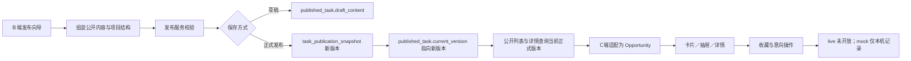
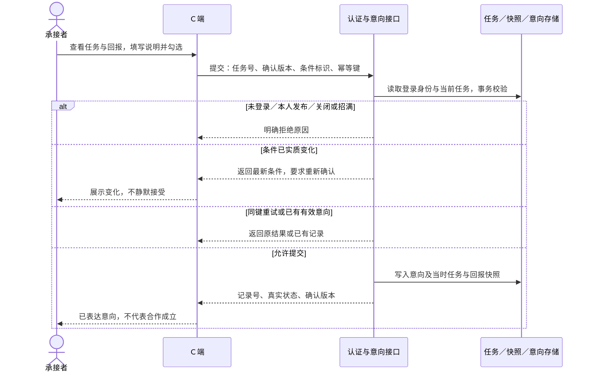
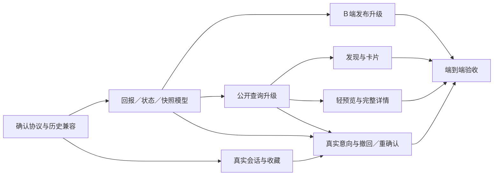

# 「发现适合你的机会」PRD V1.0 差异分析与实施计划

> 审查日期：2026-10-26。性质：源码分析，不是开发完成报告。**本轮未修改业务代码、未修改数据库、未提交代码，也未启动或停止服务。**
>
> 产品依据：本轮提供的《自由人联合体｜发现适合你的机会模块 PRD V1.0》及九项明确设计。PRD 是目标，源码是当前实现事实；两者分别标识。

## 1. 负责人先看：当前可用到哪一步

**当前已经具备“B 端确认发布 → 保存正式快照 → C 端公开查询 → 卡片、预览与详情展示”的读取链路；尚未形成真实的收藏与承接意向闭环。** 本次不是从零重做发现页，而是升级回报协议、调整信息层级，并补上真实参与记录。[B01][J05–J07][J01–J03][C06–C13]

| 关键结论 | 对本期的含义 | 证据 |
| --- | --- | --- |
| 视觉与页面骨架已存在 | 保留白底、橙红、双列卡片与右抽屉，局部调整，不重建整站 | C02、C04、C09、C15–C16 |
| 现有回报分类不是 PRD 四类 | `fixed/range/negotiable/non_cash` 是固定金额、区间、面议、非现金；不能直接重命名为现金、物品、服务、组合 | C06、B02、B04、J04–J05 |
| 正式内容已有版本快照 | 扩展已有发布快照，不能再给 C 端配置一套互不关联的任务内容 | J07、J10 |
| 抽屉实际上复用了完整正文 | `compact` 只声明、未用于控制渲染；素材、验收、项目树仍全部显示，违反“轻预览”设计 | C09–C10 |
| 收藏、意向仅 mock 有效果 | live 服务明确拒绝相关写入；C 端会话也没有接入真实账号 | C07、C12–C14 |
| 关闭、招满还没有真实参与模型支撑 | 发布状态不等于招募状态；公开适配器直接设置 `status: open`，没有已确认人数来源 | C06、J01、J03、J08–J10 |

### 1.1 分析范围与证据边界

- **C 端**：`/Users/mainto/frontfile/freeligo`，覆盖首页发现区、任务大厅、卡片、预览、详情、会话、服务适配和 mock。
- **B 端**：`/Users/mainto/Documents/Codex/2026-09-30/https-chatgpt-com-share-6abcced2-9a98/demand-workbench`，覆盖当前 React 发布向导、公开内容编辑、序列化和发布 API。**不是** `/Users/mainto/frontfile/demand-workbench` 下的迁移版本。
- **共享后端**：`/Users/mainto/javafile/demand-workbench-backend`，覆盖发现查询、发布校验、正式快照、相关迁移、登录入口及安全配置。
- 右侧任务助手、全站账号治理、AI 拆解算法、支付、物流、完整履约均不作为本期改造范围。登录只分析参与操作必需的依赖。
- **验证方式仅静态源码检查**：本轮没有浏览器操作、接口调用、数据库查询或测试运行；SQL 文件代表源码定义的目标结构，不证明某个数据库已执行迁移。没有把历史报告的测试结果作为本轮通过证据。

## 2. 当前功能是如何工作的

### 2.1 当前发布到展示链路

**事实依据**：B 端 `PublishWizard.taskPayload`、`publicationContent`；后端 `PublishTaskService.save`、`PublicationContentService.prepare`、`MyBatisPublishTaskRepository.save`；公开 SQL 的 `joins/publicWhere`；C 端 `adapt/liveService`。[B01][B03][J05–J07][J03][C06–C07]

重要边界：同一需求的发布记录由 `requirement_id` 唯一约束管理；项目介绍和工作项树属于本次正式发布内容。`projects/list` 复用任务查询，项目地址是同一发布内容的项目视角，**不能把每个树节点理解成已存在独立招募、独立报酬和独立意向的任务**。[J08][J01][B03][C11]

### 2.2 用户能看到的现有功能

| 入口 | 当前实际行为 | 尚缺什么 | 证据 |
| --- | --- | --- | --- |
| `/` 首页发现区 | 分类、四频道、城市、工作方式、预算；6 条任务；双列；错误重试、空结果清筛选 | 回报方式、综合推荐排序、追加加载 | C01–C02、C06、J03 |
| `/opportunities` 任务大厅 | 分类、搜索、城市、方式、预算及单位、新人条件、排序、8 条分页、卡片/列表切换 | 与首页不同的筛选呈现；不是同一套四频道入口 | C03 |
| 卡片 | 标题、简介、可选图片/视频封面、回报文本、地点、耗时；收藏按钮与主体独立 | 四类回报、无封面占位、统一标签与混合方式表达 | C04–C06 |
| 右侧预览 | `540px` Drawer，通过任务 ID 查询详情；底部完整详情/意向按钮 | 独立摘要、3–5 项限制、错误重试 | C09–C10 |
| `/tasks/:id` | 独立详情地址；左正文、右 sticky 操作卡；项目介绍与树 | 默认展开规则、结构化回报、真实意向状态 | C11、C16 |
| `/projects/:id` | 展示同次发布的项目结构，并可返回招募任务 | 不应扩展成独立多岗位招募系统 | C11、J01 |
| `/favorites`、`/my-interests` | 收藏路由复用大厅；“我的意向”路由仍是占位页 | 真实列表、状态与撤回 | C01、C03、C07 |

### 2.3 当前字段、接口和表

#### A. 数据是三层，不是一份通用对象

| 层次 | 当前主要字段 | 设计影响 | 证据 |
| --- | --- | --- | --- |
| B 端编辑与发布 | 标题、简介、分类、技能、人数、预算文本、日期、方式；`content` 放结构化公开内容及项目树 | 编辑态和公开态同时存在，改回报不能只修改某个输入框 | B01–B04 |
| 后端 `PublicTaskContent` | `rewardType/amountMin/amountMax/currency/unit/budgetText`；城市、预计投入、新人、范围、交付、验收、媒体、项目 | 能表达数字价格或一段非现金说明，不能表达带条件的多个回报条目 | J04–J05 |
| C 端 `Opportunity` | `reward`、`unit`、`rewardPrefix` 等展示文本；`scope/deliverables/acceptance`、媒体、项目、`status` | `adapt` 丢弃回报原始结构，写死开放状态；没有公开版本及条件标识可用于提交确认 | C06、C08 |

`summary` 目前承担介绍文字，没有独立 `goal`；工作范围、交付和验收是字符串数组。媒体模型仅图片/视频，没有通用文件附件字段。C 端本地 `Interest` 只有 `pending/accepted` 两种状态，不能直接承担 PRD 五状态协议。[C08][C10][J04]

#### B. 已存在的相关接口

| 接口 | 用途及现状 | 证据 |
| --- | --- | --- |
| `GET /api/v1/public/task-categories` | 共用分类字典；不是 C 端另一套分类 | J01 |
| `GET /api/v1/public/task-cities` | 从当前可公开的现场/混合任务汇总城市，不是全国行政区字典 | J01、J03 |
| `GET /api/v1/public/tasks/list` | `keyword/categoryCode/cityCode/workMode/newcomer/rewardType/amountMin/amountMax/unit/sort/page/pageSize`；返回分页与总数 | J01–J03 |
| `GET /api/v1/public/tasks/detail?taskNo=…` | 当前正式发布的公开详情、发布者编号/昵称、人数、媒体及项目内容 | J01、J03 |
| `GET /api/v1/public/projects/list`、`/api/v1/public/projects/detail?projectNo=…` | 复用同一发布内容的项目视角 | J01 |
| `/api/v1/requirements/publish-task`、`/save`、`/discard-draft`、`/cancel`、`/versions`、`/version` | B 端读取、保存、放弃草稿、取消和历史版本；请求方法由 B05 定义 | B05、J06–J07 |

当前后端虽接受 `rewardType`，但只接受旧四值；C 端 `browse` 没有传回报类型，传的是预算区间和单位。金额查询按**区间相交**过滤，并要求单位明确，不是统一折算后的收入排名。[C06][J02–J03]

#### C. 源码定义的数据库结构

| 表/字段 | 当前作用 | 本期关系 | 证据 |
| --- | --- | --- | --- |
| `published_task` | 需求对应发布记录、人数、发布状态；新增迁移加入 `current_version/draft_content` | 继续作为稳定任务标识、草稿与当前版本入口 | J08、J10 |
| `task_publication_snapshot` | 版本化 `content/editor_content` JSON，标题、分类、城市、方式、旧回报与金额等查询列 | 回报条目与发布条件应进入这个正式快照 | J10、J07 |
| `task_category` | 共用分类，包含启停、排序、创建来源等 | 保留；不新建 C 专用字典 | J09–J10 |
| `task_media` | 上传媒体元数据及访问关联 | 可继续复用图片/视频；文件能力须单独审查扩展 | J09、J01、J05 |
| `requirement/sys_user` 等 | 原始需求与发布者；公开查询关联用户状态 | 参与权限与“不可承接自己任务”必须由后端确认身份 | J03、J11–J13 |

**注意旧表**：`public_task_profile` 曾在早期迁移创建，随后在统一版本迁移中删除；当前发现 SQL 读的是 `task_publication_snapshot`，不能把旧 profile 表作为新改造基础。[J09–J10][J03]

当前 `src/main/java` 与 `src/main/resources/db/migration` 中搜索 `interest/favorite/withdraw/accepted` 未找到相应实现；结合 C 端 `liveService` 的明确拒绝，可确认**本次所查源码没有真实收藏/承接意向后端链路**。这不是对未连接的线上数据库或其他项目作结论。[C07][C14]

## 3. 按 PRD 逐项对照

状态定义：**已满足**指对应逻辑可在源码定位，不代表本轮实测通过；**部分满足**指骨架存在但规则不全；**未实现**指当前链路不存在；**与目标设计冲突**指现有行为明确不同，需要替换。

### 3.1 发现、筛选和卡片

| PRD 目标 | 判断 | 当前事实与改造点 | 证据 |
| --- | --- | --- | --- |
| 白底、橙红、PC 双列 | 已满足 | 保留现有布局与视觉变量；移动端效果仍需实测 | C02、C15–C16 |
| 共用技能分类，单选/全部 | 已满足 | 首页/大厅已有分类查询与筛选；首页“更多分类”目前转大厅 | C02–C03、J01 |
| 四频道及组合筛选 | 部分满足 | 首页有四频道；大厅是另一套控件，需要共用查询定义 | C02–C03 |
| 为你发现：近期+完整度综合排序 | 与目标设计冲突 | SQL 不区分两种 sort，都按发布时间加 taskNo 倒序；无完整度权重 | J02–J03 |
| 最新发布稳定倒序 | 已满足 | SQL 用 `COALESCE(t.published_at,p.published_at)` 加 taskNo；“首次/最近发布”口径仍需明确 | J03 |
| 身边机会：手动城市+现场/混合 | 已满足 | 首页要求先选城市；SQL 城市条件限定 onsite/hybrid | C02、J03 |
| 新人频道由发布者标记 | 已满足 | B 端录入 newcomer，公开快照和查询使用该字段 | B02、J03–J05 |
| 四种回报方式+可选现金区间 | 与目标设计冲突 | 页面只有预算；旧 rewardType 混合了计价方式与回报性质 | C02–C03、C06、J04–J05 |
| 更多任务追加加载 | 与目标设计冲突 | 首页跳大厅，大厅分页；都不是在原列表追加 | C02–C03 |

| PRD 卡片要求 | 判断 | 当前事实与改造点 | 证据 |
| --- | --- | --- | --- |
| 标题/简介最多两行 | 部分满足 | 首页简介两行，但标题 CSS 是单行省略；应统一两套卡片 | C04–C05、C15 |
| 无封面简洁占位 | 与目标设计冲突 | 当前无图时取消图片区，而非统一占位 | C04–C05 |
| 分类必显、技能最多 2 个 | 部分满足 | 首页优先 tags，可能只显示技能，不保证分类；未限制技能数量；大厅标签结构又不同 | C04–C06 |
| 回报类型和自动摘要 | 未实现 | 没有物品/服务/组合条目；现有文本不能可靠还原这些语义 | C06、C08、J04 |
| 工作方式、条件城市、可选时间 | 部分满足 | 发布校验现场/混合城市；首页将非远程概括为线下；卡片主要用预计投入，缺完整时间兜底规则 | B02、J05、C04–C05 |
| 骨架/空态清筛选/列表重试 | 已满足 | 页面已具备，须在改造后保留；不代表抽屉也有重试 | C02–C03、C09 |
| 收藏独立点击且真实保存 | 部分满足 | 独立按钮已实现；live 未接入，mock 本机保存 | C04–C05、C07、C14 |

### 3.2 预览与详情

| PRD 目标 | 判断 | 当前事实与改造点 | 证据 |
| --- | --- | --- | --- |
| PC 右侧 480–560px 抽屉；移动端直达详情 | 已满足 | 当前 540px；页面在宽度不超过 760px 时直接跳详情；断点体验待实测 | C02–C03、C09 |
| 换卡更新而非堆叠 | 已满足 | 同一预览 ID 驱动 queryKey；ID 变化关闭意向表单 | C02–C03、C09 |
| 预览只含目标、3–5 项工作、回报、地点时间 | 与目标设计冲突 | 复用完整 TaskBody；`compact` 未控制内容；验收、素材、项目树均进入抽屉 | C09–C10 |
| 发布人昵称及身份 | 部分满足 | 有昵称和“项目发布者”静态角色文字，无认证身份属性；角色不能冒充认证 | C10、J01 |
| 关闭预览保留列表上下文 | 部分满足 | URL query 管理预览；路由同路径不主动滚顶；但大厅 watch 全部 query 会重置分页，预览操作也可能回第一页 | C01、C03 |
| 关闭按钮/遮罩/Esc | 部分满足 | 使用 Element Plus Drawer 关闭事件；未单独实现或验证三种入口，验收时须实测 | C09 |
| 失败可重试、不显示上一任务 | 部分满足 | ID 隔离查询、错误面板已有；预览无重试按钮，快速切换及失败组合未运行验证 | C09 |
| 独立详情地址与左右分栏、右侧吸附 | 已满足 | `/tasks/:id`、detail-layout、sticky 操作卡；具体约 70/30 须结合真实宽度校验 | C01、C11、C16 |
| 右栏回报/操作/发布者/基本信息 | 部分满足 | 回报和操作在右；发布者仍在左侧正文；回报是文本而非条目 | C10–C11 |
| 范围前 3 项可展开、验收折叠 | 未实现 | 所有数组直接渲染，没有折叠状态 | C10 |
| 图片/视频/文件参考材料 | 部分满足 | 图片与视频已有；无通用文件模型或入口 | C08、C10、J04 |
| 发布必须明确目标、主要工作、交付成果 | 部分满足 | 标题/简介等校验存在；范围/交付/验收数组允许空，范围可用工作项名补齐；不能保证内容明确 | B01–B03、J05–J06 |

### 3.3 参与操作与业务边界

| PRD 目标 | 判断 | 当前事实与改造点 | 证据 |
| --- | --- | --- | --- |
| 登录后返回原任务继续提交 | 未实现 | live 的 requireLogin 直接提示未接入；mock 登录回调不是真实认证 | C13、C07 |
| 简短说明+回报条件+必勾确认 | 与目标设计冲突 | 当前表单必填经历与开始日期，缺确认勾选；标题回报仍硬编码人民币符号 | C12 |
| 后端生成意向、查询、撤回 | 未实现 | live submit 不可用；我的意向占位；无真实撤回接口 | C01、C07、C12–C14 |
| 不承接自己任务、唯一有效意向、幂等 | 未实现 | 仅 mock/按钮有部分防护，不能防绕过或并发；没有后端存储约束 | C09、C11、C14 |
| 关闭/招满拒绝新提交 | 未实现 | 有发布取消，但无真实意向及确认人数；公开适配写死 open，取消后查询查不到不等于保留关闭详情 | J03、C06、J08–J10 |
| 提交保存任务及回报条件快照 | 未实现 | 发布快照已存在，但没有“谁基于哪个条件表达意向”的记录 | J07、C07 |
| 条件实质变化提示重新确认 | 未实现 | C 端没有版本/条件指纹、意向也无确认依据 | C06、C08、C12 |
| 五状态，接受/婉拒待真实处理入口后开放 | 未实现 | mock 只有 pending/accepted；不能拿模拟接受作为真实状态来源 | C08、C14 |
| 不做支付、物流、合同与完整履约 | 已满足 | 所查页面和该业务链路没有这些能力；继续排除，不为回报条目引入交易系统 | C11–C12、J04–J07 |

## 4. 建议的目标实现：先统一数据，再调整页面

以下均为**建议方案，尚未实现**。目标是复用共用发布内容，避免“B 端一份、C 端另一份”失去一致性。

### 4.1 回报协议：回报性质与现金计价方式分开

建议在公开内容中增加 `schemaVersion`，将回报建模为 `reward.kind + reward.items`，不要直接改旧 `rewardType` 四值而不提供兼容。

| 对象 | 建议最少字段/规则 |
| --- | --- |
| 回报整体 | `kind: cash/goods/service/mixed`；非空 items；mixed 至少两个有效条目 |
| 现金条目 | `type: cash`；金额最小/最大值、币种、计价单位；固定/区间是现金内部规则 |
| 物品条目 | `type: goods`；名称、数量、状态及包含物说明；图片/型号/参考估值/交付方式可选 |
| 服务条目 | `type: service`；名称、服务范围、交付内容；时长/地点/有效期可选 |
| 通用条件 | 条目补充条件、整体合作说明；不能强制把非现金折算金额 |

组合回报允许“物品+服务”，**不能默认组合一定含现金**。建议后端生成/返回明确摘要，前端共享格式化规则，详情始终保留完整条目与条件，不把摘要当原始事实保存。

金额筛选应约定：只对现金或包含现金的 mixed 生效；按相同币种、单位比较，沿用区间相交规则或在确认后修改。不建议把“每小时”和“每项目”混在一个区间里，也不能将物品估值当现金收入。

### 4.2 前端改造范围

| 文件/模块 | 建议调整 | 复用/保留 |
| --- | --- | --- |
| `domain/models.ts`、`services/publicTasks.ts`、`services/contracts.ts` | 新回报联合类型、版本/招募状态、查询字段、意向结果；适配历史内容；取消伪造 open | Zod 校验、错误不静默转 mock |
| HomePage / DiscoveryPage | 共用筛选与频道规则；预算改回报方式；现金条件动态显示；加载更多；预览参数不触发分页归零 | 两入口可保留，但必须使用同一业务规则 |
| HomeOpportunityCard / OpportunityCard | 统一展示模型或共用卡片主体；分类+最多2技能；两行标题；占位；真实回报摘要/工作方式 | 双列与视觉样式、独立收藏点击 |
| PreviewDrawer | 新建轻量预览内容组件；目标简述、主要工作3–5项、回报优先、地点时间、发布人；加重试 | Drawer 外壳、540px、queryKey 隔离 |
| DetailPage / TaskBody | 共用回报展示组件；范围默认3项展开，验收折叠；发布者移右栏；保留项目入口与公开树 | 独立地址、右侧吸附、图片视频浏览 |
| InterestForm / account/session | 简短说明+真实条件+勾选确认；接真实会话；提交/查询/撤回/重确认与错误码 | 使用远端状态缓存，不再用 revision+本机查询模拟服务状态 |
| `/my-interests` 相关页面 | 从占位升级为本期必要的记录/状态/撤回入口；也可先做简洁记录列表 | 不扩展聊天、支付、交付管理 |

范围与层级的区别要保留：`scope[]` 是公开工作说明，`project.tasks` 是已有项目工作项层级。AC-08 要求“完整层级”，建议详情展开可查看当前正式快照里的公开树；抽屉不展示树。不要为了展示展开而新建一套独立工作项发布/招募模型。[C08][C10–C11][B03]

### 4.3 后端接口调整与新增

以下路径为建议命名，**不代表当前已存在**；具体命名应遵循项目现有 API 风格。

| 范围 | 建议 | 验收关注点 |
| --- | --- | --- |
| 现有发布保存 | 升级 PublicTaskContent、编辑态与服务端校验，区分草稿和正式要求 | 草稿允许未填完整；新正式发布必须满足四类回报与目标/工作/交付 |
| 现有公开列表 | 新增 `rewardKind` 等明确筛选；返回卡片摘要、状态；实现 recommended 和 latest 的差异 | 组合无现金不进入现金金额结果；总数与列表使用同一过滤条件 |
| 现有公开详情 | 返回 `publicationVersion`、确认条件标识、完整回报、招募状态及发布者角色 | 卡片/预览/详情同一事实；旧内容可读；无内部隐私字段 |
| 预览查询 | 优先复用详情响应后做轻展示；媒体体积确有压力再增加摘要响应 | 不为一个 UI 组件机械新增一套业务数据 |
| 意向提交，例如 `/api/v1/task-interests/submit` | 使用登录用户；校验任务、自己任务、重复有效意向、幂等键及确认版本；事务写入快照 | 禁止前端传 userId 决定申请人；并发/重试不产生重复 |
| 我的意向查询/详情、撤回 | 查询本人记录与状态；撤回只允许合法状态和本人；操作幂等 | 状态可刷新后恢复；无权读写他人记录；成功后更新缓存 |
| 条件变更确认 | 返回明确冲突码与最新条件；提供重新确认流程 | 用户不能在读旧条件后静默提交新条件 |
| 收藏/取消/本人收藏 | 实现真实登录用户与任务关联，可用幂等 PUT/DELETE 或项目现有命令风格 | 刷新和跨设备可读；登录退出清除用户专属缓存 |

**认证依赖不能遗漏**：后端已有短信登录和 Cookie 会话，但 `AuthService` 使用固定开发验证码，发送接口还返回 developmentCode；它是现有开发登录能力，不是生产短信认证。C 端应接入现有身份与会话接口，生产开放前另外收紧开发登录行为，不能把 mock 身份转换为真实授权。[J11–J13][C13]

### 4.4 数据库建议

| 调整项 | 建议方案 | 原因/限制 |
| --- | --- | --- |
| 版本化回报内容 | 在正式快照 content JSON 增加 reward/items/schemaVersion | 回报属于发布事实，不应被一个可变公共回报对象覆盖 |
| 查询投影 | 快照增加 reward_kind、contains_cash，以及可筛选现金金额/单位字段；用新增迁移维护索引 | 列表不依赖解析长文本；旧字段迁移期保留；多现金条目聚合口径先确认 |
| 招募状态 | 在稳定任务维度增加独立招募状态/关闭原因，或新增招募记录表 | 与 draft/published/cancelled 分离；不能靠 C 端推断 |
| 意向主记录 | 新表：稳定任务编号、申请人、状态、说明、提交/更新/撤回时间、确认发布版本、条件快照/标识 | “发布快照”不能代替“用户确认记录” |
| 唯一及幂等约束 | 用户+任务的有效记录约束；幂等请求键、请求摘要与返回结果；必要的状态事件记录 | 数据库兜底并发；同键不同内容应拒绝，不仅禁用按钮 |
| 收藏 | 用户+任务唯一记录及时间 | 不使用 localStorage 充当正式收藏 |

第一版可把回报条目存入不可变快照 JSON，再用查询列投影，不必立刻新增多张可变“物品/服务”主数据表。若后续需要按每个条目检索，再增加**与发布版本绑定**的条目表。

意向唯一约束建议采用“每用户/任务一个当前记录 + 独立历史事件”的简洁方式；如果撤回后允许重投，必须保留旧提交快照和尝试历史，不能覆盖为仿佛第一次提交。此方案尚需确认撤回后重投政策。

### 4.5 真实意向链路及一致性

提交与关闭、后续接受/招满必须采用一致的事务/锁定或条件更新规则；前端按钮禁用只是反馈。不要在提交意向时就占用承接名额，否则“表达意向”会错误地变成先到先得接单。

第一阶段只开放待回应、主动撤回和有真实关闭原因的已关闭；接受、婉拒需等发布者真实处理入口实现后再产生。PRD 的“已接受”仅表示愿意进一步合作，不能直接复用 mock 的“接受即招满关闭”逻辑。[C14]

对实质变更，建议保留原提交快照不变，返回 `confirmationRequired` 和最新条件供用户重确认；确认动作追加记录。不能因发布者改了最新版本就改写用户原先接受的条件。哪些字段属于实质变更需在开发前明确。

## 5. 对 B 端发布模块的影响与迁移风险

### 5.1 必须同步调整 B 端

1. **发布录入**：旧“固定/区间/面议/非现金”改成四类回报，现金内部再选择固定/区间；物品和服务表单按字段校验；组合支持多条目。
2. **草稿恢复与预览**：更新 `publicationEditorState/publicationContent/rewardLabel` 以及 PublicTaskPreview 的消费数据；预览与 C 端使用同一回报语义及校验规则，不能各自猜摘要。
3. **发布服务**：`PublicationContentService.prepare` 当前会用外层 budget 覆盖 budgetText；改造后必须明确新的权威字段，避免旧预算文本盖掉新回报。公开范围和交付应在正式发布要求完整，草稿不强制。
4. **版本管理**：沿用草稿隔离、正式追加快照、放弃草稿、历史只读。新增字段必须同时覆盖公开 content 和编辑 editor_content 的序列化与恢复。
5. **暂不要求新增履约系统**：本期只补接收真实意向的必要数据；发布者处理接受/婉拒可紧接着独立开发，不能让本期页面出现虚假处理结果。

依据：B01–B05、J05–J07。当前发布允许范围/交付为空是既有行为；本 PRD 对新正式发布提出更严格要求，属于有意变更，不应误判为此前所有旧数据都不合法。

### 5.2 风险与处理顺序

| 风险 | 影响 | 建议 |
| --- | --- | --- |
| 新枚举直接替换旧枚举 | B/C 两端 Zod 和 Java 校验互不兼容，任务可能整页读取失败 | 先发布兼容读端和后端，再开放新版发布；必要时版本化协议 |
| 历史 non_cash 无法识别物品/服务 | 文本猜测会改变发布者承诺 | 标为历史回报说明，提示发布者补录；不自动分配类型 |
| 历史 negotiable 无法满足现金金额必填 | 自动补 0 或“现金”会误导 | 保持历史可读；新发布/编辑再发布要求选择有效新回报 |
| 编辑旧快照回填新字段 | 破坏版本事实和意向确认依据 | 历史快照不改写；兼容读取或生成经过确认的新版本 |
| 多处价格来源 | budget、旧金额和新条目可能矛盾 | 确立唯一新内容源，旧 budget 仅兼容摘要，禁止双向任意覆盖 |
| 只升级 content，遗漏 editor_content | B 端恢复草稿/历史时丢失条目 | 新旧编辑态都做兼容恢复与版本测试 |
| 取消发布后详情 404 | 有意向用户无法追溯条件；无法显示结束提示 | 区分公开发现下架与本人记录访问历史快照，制定权限，不直接全部公开历史 |
| 金额单位/混合现金投影含糊 | 错筛、错总数、遗漏组合回报 | 约定单位、币种、多现金条目规则后再设计索引与筛选 |

新增独立迁移文件，不修改已经执行过的历史迁移。迁移前做旧 rewardType、空工作/交付、非法城市、缺媒体引用等数据盘点与备份；**本轮未执行盘点，也不知道各类历史数据数量**。

## 6. 依赖顺序与实施任务

### 阶段 A：数据与发布基础

| 任务 | 改造范围 | 完成/验收标准 |
| --- | --- | --- |
| T0 协议与决策冻结 | 目标 schema、旧数据读取、现金筛选、条件变化及意向政策 | 四种回报 JSON 样例、旧版样例和错误码评审通过；第7节关键问题有结论；不把建议当已批准需求 |
| T1 模型与迁移 | PublicTaskContent、快照投影、招募状态、必要新增表与索引 | 新旧内容可反序列化；历史快照不变；mixed 无现金可保存；迁移/回退应用兼容方案明确 |
| T2 B 端发布升级 | 发布向导、表单、预览、序列化、草稿恢复及服务端校验 | 四类回报可草稿/发布/再编辑/放弃；每类缺字段正式发布被拒；目标/主要工作/交付必需；C 读到同一版本；历史可读 |
| T3 公开查询升级 | 列表/详情 DTO、过滤/总数、排序、版本与状态 | 分类+频道+城市+方式+回报同时生效；现金金额仅筛现金及含现金组合；recommended 与 latest 规则有差异且稳定；关闭任务处理符合约定（AC-01/02/03/04/11/14） |

### 阶段 B：可阅读、可判断的页面

| 任务 | 改造范围 | 完成/验收标准 |
| --- | --- | --- |
| T4 发现与卡片 | 首页/大厅共用筛选、卡片、加载更多、URL状态 | 切筛选重置分页，预览开关不重置分页；追加不重复/漏项；标题简介两行；无图占位；分类+最多2技能；四类摘要正确；组合无现金不显示 ¥（AC-01～06/12/14） |
| T5 预览与详情 | 独立轻预览、回报组件、折叠范围与验收、返回上下文 | 540px 或确认宽度；预览工作≤5项，无树/完整验收；详情前3项展开及层级；右栏发布人/回报/操作；关闭/遮罩/Esc、快速换卡、失败重试均通过；移动端直达详情（AC-05～08/12～14） |

### 阶段 C：真实参与闭环

| 任务 | 改造范围 | 完成/验收标准 |
| --- | --- | --- |
| T6 真实会话与收藏 | C 端会话、现有认证接口对接、用户缓存隔离、收藏存储/API | 登录后回原任务；刷新恢复登录；退出后不显示前一用户记录；收藏只影响自己，跨会话持久化；开发固定验证码不作为生产认证验收 |
| T7 意向提交与状态 | 新接口/表、幂等、权限、条件快照、撤回、重确认、简洁我的意向页 | 简短说明+确认必填；API/DB 真实记录；重复及并发不重复；不可承接自己/关闭/招满任务；已提交按钮状态恢复；本人撤回可查；条件变更显式确认；不生成假的接受/婉拒状态（AC-09～12/14） |
| T8 联调与回归 | 前端检查、后端测试、浏览器/API/数据库验证 | 新建发布到C发现到意向记录全链路；四回报、新旧版本、权限、并发、关闭及错误恢复用例通过；保留具体证据，不以页面提示成功代替数据库验证 |

执行时可在 T1 协议明确后并行开发发布端与展示端；**不能只上线能发新数据的一端，导致旧读端报错**。每阶段应交付可审阅差异和测试证据，再进入下一步，不在本轮开始实施。

## 7. 开发前仍需要负责人确认的细节

这些问题不推翻已经确认的四类回报和核心流程，只补齐会影响实现的空白。

| 决策 | PRD 已明确 / 当前缺口 | 建议及需要确认的问题 |
| --- | --- | --- |
| 历史“面议/非现金” | 新回报四类已明确；旧文本不能无损归类 | 历史仍可读并标为旧版说明，编辑再发布时补齐；是否允许旧任务继续接收意向？必须展示实际旧条件，不虚构回报 |
| 为你发现权重 | 近期+信息完整已明确；权重未定义 | 明确完整度项和排序权重，保留稳定 taskNo 兜底；不扩展个性化推荐 |
| 发布时间 | 最新倒序明确；首次发布还是最近再发布不明确 | 建议公开显示并按“最近正式发布时间”排序，同时保留首次时间；需确认是否允许编辑重新顶序 |
| 组合条目规则 | 至少2个，可不含现金 | 是否允许同类型多个条目？多个现金是否允许不同单位？建议一期最多一个现金条目以简化筛选，但这是新增约束，必须先获确认 |
| 有效意向与重投 | 只能一条有效意向、允许撤回 | 撤回后能否重投？待回应/已接受分别能否撤回？建议待回应可撤回，重投留历史；接受后政策留给处理阶段确认 |
| 招满含义 | 招满禁止新提交；接受仅进一步合作 | 什么行为占名额？建议意向不占名额，后续明确确认机制；一期不能靠 pending 数判断招满 |
| 实质变化 | 必须提示重新确认 | 建议回报、范围、交付、重要日期/地点纳入条件指纹；标题错字不必重确认；具体字段及重确认入口需确认 |
| 目标及层级 | 目标必须明确、AC-08展开层级 | summary 是否同时承担目标？建议先共用，避免重复填写；层级沿用已公开项目树，是否符合预期？ |
| 发布者身份 | 昵称+身份已明确 | 一期显示“发布者”业务角色即可；若要“正式/认证发布者”，必须定义可信来源，不能静态冒充认证 |
| 文件素材 | PRD 包含文件；现模型只有图片/视频 | 若本期严格覆盖则扩展上传类型与公开授权；否则明确列为经确认的延期项，不默认为已有 |

## 8. 验收与本轮验证记录

### 8.1 开发后必须执行的重点用例

| 组别 | 关键用例 | 验证层次 |
| --- | --- | --- |
| 查询 | 四频道与所有组合筛选；无现金 mixed；同金额不同单位；总数；追加去重；筛选切换重置 | 浏览器+API+SQL结果 |
| 展示 | 四回报完整条目与条件；无封面；长标题；混合工作方式；历史面议；手机直达详情 | 浏览器+响应对照 |
| 抽屉 | 打开/换卡/关遮罩/Esc；第二页打开后仍在第二页；网络失败重试不展示上一任务 | 浏览器+请求记录 |
| 详情 | 前3项展开、完整层级、验收默认折叠；项目公开树保留；返回列表上下文 | 浏览器 |
| 意向 | 登录返回、本人任务禁止、缺勾选拒绝、真实写入、刷新已提交、本人撤回、越权拒绝 | 浏览器+API+DB |
| 一致性 | 双击及并发提交、同幂等键不同请求、提交与关闭竞争、旧版本条件提交、实质变化重确认 | 接口并发测试+DB约束 |
| 发布兼容 | 旧草稿恢复、四类新发布、历史只读、放弃草稿不改正式版、旧读端升级顺序 | B/C联调+快照核对 |

### 8.2 本轮实际完成与未完成

| 项目 | 本轮结果 |
| --- | --- |
| PRD 全文阅读 | 已完成，覆盖正文及 AC-01～14 |
| 前后端核心源码与 SQL 阅读 | 已完成，依据见第9节；负向结论限定于本次项目源码 |
| 现有测试文件检查 | 查阅了公开任务适配和 mock 测试文件；未执行，不代表通过（C17–C18） |
| 浏览器视觉/交互 | 未执行；本报告不保证当前像素、响应式、Drawer 默认行为或快速换卡实测结果 |
| 接口、登录、数据库迁移状态 | 未运行验证；不确认本机/线上已有数据、部署版本或已迁移状态 |
| 数据修改、代码改造、提交 | 均未执行；本轮只新增本分析文档 |

## 9. 关键源码索引

说明：文中 `[Cxx] / [Bxx] / [Jxx]` 是证据编号；以下给出文件、定位及关键符号。链接行号为本轮读取时定位，后续代码变化需重新确认。

### 9.1 C 端

- **C01** [src/app/router.ts](/Users/mainto/frontfile/freeligo/src/app/router.ts:8) — router.routes / scrollBehavior：页面入口与滚动策略。
- **C02** [src/modules/discovery/HomePage.vue](/Users/mainto/frontfile/freeligo/src/modules/discovery/HomePage.vue:1) — HomePage 查询、频道、筛选、open/favorite、查看更多事件。
- **C03** [src/modules/discovery/DiscoveryPage.vue](/Users/mainto/frontfile/freeligo/src/modules/discovery/DiscoveryPage.vue:1) — DiscoveryPage 查询/分页/route.query watcher、open 与筛选模板。
- **C04** [src/modules/discovery/components/HomeOpportunityCard.vue](/Users/mainto/frontfile/freeligo/src/modules/discovery/components/HomeOpportunityCard.vue:1) — HomeOpportunityCard 标签、图片条件、回报/地点/按钮模板。
- **C05** [src/shared/ui/OpportunityCard.vue](/Users/mainto/frontfile/freeligo/src/shared/ui/OpportunityCard.vue:1) — OpportunityCard 展示及独立收藏按钮。
- **C06** [src/services/publicTasks.ts](/Users/mainto/frontfile/freeligo/src/services/publicTasks.ts:145) — contentSchema / taskSchema / adapt / browse / publicDetail：公开协议、展示转换与请求参数。
- **C07** [src/services/index.ts](/Users/mainto/frontfile/freeligo/src/services/index.ts:5) — liveService / unavailable：真实写入禁用与服务选择。
- **C08** [src/domain/models.ts](/Users/mainto/frontfile/freeligo/src/domain/models.ts:17) — Opportunity / SearchQuery / Interest / PublishInput：前端领域数据。
- **C09** [src/modules/tasks/PreviewDrawer.vue](/Users/mainto/frontfile/freeligo/src/modules/tasks/PreviewDrawer.vue:16) — useQuery / participate / detail 与 Drawer 模板。
- **C10** [src/modules/tasks/TaskBody.vue](/Users/mainto/frontfile/freeligo/src/modules/tasks/TaskBody.vue:12) — TaskBody props 和各 section：compact 未参与渲染、全量范围/验收/项目树。
- **C11** [src/modules/tasks/DetailPage.vue](/Users/mainto/frontfile/freeligo/src/modules/tasks/DetailPage.vue:14) — DetailPage 查询、收藏/意向、右栏与项目视角。
- **C12** [src/modules/tasks/InterestForm.vue](/Users/mainto/frontfile/freeligo/src/modules/tasks/InterestForm.vue:1) — InterestForm 字段校验、service.submit 与模拟成功提示。
- **C13** [src/modules/account/session.ts](/Users/mainto/frontfile/freeligo/src/modules/account/session.ts:19) — useSession / requireLogin：本机演示会话与真实模式阻断。
- **C14** [src/services/mock/index.ts](/Users/mainto/frontfile/freeligo/src/services/mock/index.ts:117) — mockService.favorite / submit / accept：本机持久化、重复与名额模拟。
- **C15** [src/styles/reference.css](/Users/mainto/frontfile/freeligo/src/styles/reference.css:428) — home-card-copy h3 / p：标题单行、简介两行。
- **C16** [src/styles/main.css](/Users/mainto/frontfile/freeligo/src/styles/main.css:988) — detail-layout / participation-panel / opportunity-grid：分栏、吸附及响应式。
- **C17** [src/services/publicTasks.test.ts](/Users/mainto/frontfile/freeligo/src/services/publicTasks.test.ts:1) — 公开请求/适配测试，仅查阅，未执行。
- **C18** [src/services/mock/mock.test.ts](/Users/mainto/frontfile/freeligo/src/services/mock/mock.test.ts:1) — mock 行为测试，仅查阅，未执行。

### 9.2 当前 React B 端

- **B01** [src/components/PublishWizard.jsx](/Users/mainto/Documents/Codex/2026-09-30/https-chatgpt-com-share-6abcced2-9a98/demand-workbench/src/components/PublishWizard.jsx:115) — PublishWizard.taskPayload / confirmPublish / saveDraft / discardDraft。
- **B02** [src/features/publishing/components/TaskContentFields.tsx](/Users/mainto/Documents/Codex/2026-09-30/https-chatgpt-com-share-6abcced2-9a98/demand-workbench/src/features/publishing/components/TaskContentFields.tsx:8) — TaskContentFields / LineField：旧回报编辑、城市、范围/交付、媒体。
- **B03** [src/features/publishing/components/publicationPreviewModel.ts](/Users/mainto/Documents/Codex/2026-09-30/https-chatgpt-com-share-6abcced2-9a98/demand-workbench/src/features/publishing/components/publicationPreviewModel.ts:55) — publicationContent / publicationEditorState / buildPublicProject / rewardLabel。
- **B04** [src/features/publishing/api/taskContentApi.ts](/Users/mainto/Documents/Codex/2026-09-30/https-chatgpt-com-share-6abcced2-9a98/demand-workbench/src/features/publishing/api/taskContentApi.ts:47) — 内容 Zod schema / 分类与媒体 API。
- **B05** [src/features/publishing/api/publishTaskApi.ts](/Users/mainto/Documents/Codex/2026-09-30/https-chatgpt-com-share-6abcced2-9a98/demand-workbench/src/features/publishing/api/publishTaskApi.ts:44) — 发布保存、读取、放弃草稿、取消、历史版本请求。

### 9.3 共享后端

- **J01** [src/main/java/com/demandworkbench/discovery/controller/DiscoveryController.java](/Users/mainto/javafile/demand-workbench-backend/src/main/java/com/demandworkbench/discovery/controller/DiscoveryController.java:26) — DiscoveryController 列表/详情/分类/城市；TaskResponse。
- **J02** [src/main/java/com/demandworkbench/discovery/application/DiscoveryService.java](/Users/mainto/javafile/demand-workbench-backend/src/main/java/com/demandworkbench/discovery/application/DiscoveryService.java:12) — DiscoveryService.list / 查询校验：页大小、旧回报、金额单位。
- **J03** [src/main/resources/com/demandworkbench/discovery/infrastructure/persistence/DiscoveryMapper.xml](/Users/mainto/javafile/demand-workbench-backend/src/main/resources/com/demandworkbench/discovery/infrastructure/persistence/DiscoveryMapper.xml:4) — joins / publicWhere / filters / list / count / accessibleDetail：当前版本、过滤、排序与访问条件。
- **J04** [src/main/java/com/demandworkbench/discovery/domain/PublicTaskContent.java](/Users/mainto/javafile/demand-workbench-backend/src/main/java/com/demandworkbench/discovery/domain/PublicTaskContent.java:8) — PublicTaskContent record：后端公开内容协议。
- **J05** [src/main/java/com/demandworkbench/discovery/application/PublicationContentService.java](/Users/mainto/javafile/demand-workbench-backend/src/main/java/com/demandworkbench/discovery/application/PublicationContentService.java:9) — PublicationContentService.prepare / validate：字段归一、旧回报校验、可空数组、媒体。
- **J06** [src/main/java/com/demandworkbench/requirement/application/PublishTaskService.java](/Users/mainto/javafile/demand-workbench-backend/src/main/java/com/demandworkbench/requirement/application/PublishTaskService.java:11) — PublishTaskService.save / cancel / discardDraft / versions：发布权限与状态规则。
- **J07** [src/main/java/com/demandworkbench/requirement/infrastructure/persistence/MyBatisPublishTaskRepository.java](/Users/mainto/javafile/demand-workbench-backend/src/main/java/com/demandworkbench/requirement/infrastructure/persistence/MyBatisPublishTaskRepository.java:40) — MyBatisPublishTaskRepository.save / findByRequirementNo / discardDraft：草稿与正式快照。
- **J08** [src/main/resources/db/migration/V202610131500__create_published_task_tables.sql](/Users/mainto/javafile/demand-workbench-backend/src/main/resources/db/migration/V202610131500__create_published_task_tables.sql:1) — published_task 建表、需求唯一约束、人数与旧预算字段。
- **J09** [src/main/resources/db/migration/V202610251400__create_public_task_discovery.sql](/Users/mainto/javafile/demand-workbench-backend/src/main/resources/db/migration/V202610251400__create_public_task_discovery.sql:1) — 早期 task_category / public_task_profile / task_media 结构。
- **J10** [src/main/resources/db/migration/V202610251600__unify_task_publication_versions.sql](/Users/mainto/javafile/demand-workbench-backend/src/main/resources/db/migration/V202610251600__unify_task_publication_versions.sql:10) — 统一发布版本迁移：快照、投影、分类来源、旧表删除及历史补偿。
- **J11** [src/main/java/com/demandworkbench/identity/controller/AuthController.java](/Users/mainto/javafile/demand-workbench-backend/src/main/java/com/demandworkbench/identity/controller/AuthController.java:21) — AuthController 短信发送、登录和会话 Cookie。
- **J12** [src/main/java/com/demandworkbench/identity/application/AuthService.java](/Users/mainto/javafile/demand-workbench-backend/src/main/java/com/demandworkbench/identity/application/AuthService.java:17) — AuthService 验证码与会话实现：开发固定验证码，不是生产短信服务。
- **J13** [src/main/java/com/demandworkbench/config/SecurityConfig.java](/Users/mainto/javafile/demand-workbench-backend/src/main/java/com/demandworkbench/config/SecurityConfig.java:14) — SecurityConfig：公开读权限与其余 API 认证要求。

---

**下一步边界：等待负责人确认本报告及第7节决策后，再进入代码与数据库改造。**
