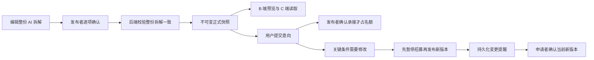

# 完整任务详情｜实施与验收说明

更新：2026-10-27。本文记录本轮实际实现，不替代产品 PRD。

## 1. 你可以看到什么

| 位置 | 本轮变化 |
| --- | --- |
| B 端需求发布 | 编辑目标、协作说明、四类回报；确认整份 AI 拆解；同章节发布预览 |
| B 端已发布任务 | 暂停／恢复招募、查看申请、确认承接／拒绝 |
| C 端预览 | 任务摘要、精简工作范围、回报与操作，进入独立详情 |
| C 端完整详情 | 内容与操作左右分栏；工作范围分层展开；验收折叠；参考图片、视频与文件；移动端单列 |
| C 端个人操作 | 真实登录、收藏、提交／撤回意向、条件变更重新确认、查看自己确认的版本 |

普通任务与软件项目共用一份模板，区别来自工作范围层级与字段内容，不另设软件专用页面。可选目标、交付、验收等为空时不制造内容；工作项不独立招募或报价。

### 页面截图

截图来自实际组件渲染，采用明确的测试数据，不是生产数据。

- [软件项目桌面详情](c-software-desktop.png)
- [物品＋服务组合回报详情](c-noncash-desktop.png)
- [手机详情](c-mobile.png)
- [B 端发布预览](b-full-preview.png)

## 2. 生效方式

没有启动、重启或停止用户管理的服务，也没有修改用户开发数据库。请按各仓库 README 的原有方式手动启动前后端；后端启动时 Flyway 自动执行新增迁移 `V202610261200__task_detail_interactions.sql`。旧服务进程不会自动加载 Java 新代码。

实际修改仓库：

- B：`/Users/mainto/Documents/Codex/2026-09-30/https-chatgpt-com-share-6abcced2-9a98/demand-workbench`
- C：`/Users/mainto/frontfile/freeligo`
- 共享后端：`/Users/mainto/javafile/demand-workbench-backend`

未修改不再使用的 Vue B 端仓库。未覆盖后端原有本地 `application.yml` 修改。未提交 Git。

## 3. 发布与版本规则

- 发布范围为整份当前拆解；不允许提交缺项、过期拆解或未确认的范围。不公开内部角色、状态、依赖和日期。
- 提交意向不占用名额，确认承接才占用；名额判断与更新在同一事务和任务行锁内。
- 已撤回可重新提交；已拒绝不允许重投；已确认承接不允许直接撤回。
- 旧版本申请不能直接被确认承接；重新确认必须携带当前版本，防止用户确认未读的新条件。
- 已有意向后，范围、回报、时间、方式、地点、人数等关键条件变化必须先暂停再发布；标题、摘要等非关键修正不要求重新确认。
- 暂停、招满、结束的任务退出公开发现列表，但原详情仍可查看。结束后重新开放规则尚未确定，本轮保守禁止重新开放。
- 提交 requestNo 支持重试幂等，旧请求不能在撤回后重新激活意向。
- 条件变化提醒已持久化，并在我的意向展示；没有接入短信、飞书或推送通知。

## 4. 数据落地与 PRD 表设计的适配

本轮没有照搬另一套重复的发布模型：复用现有草稿及正式 JSON 快照，保留历史兼容。完整 AI 树、目标、协作和结构化回报冻结于正式内容，意向事件保存确认版本与提交内容。

| 实际表 | 用途 |
| --- | --- |
| `published_task` | 当前正式版本指针、招募状态、确认基准版本 |
| `task_publication_snapshot` | 不可变公开内容／编辑内容，含完整树及回报 |
| `task_interest` | 每任务每申请者唯一的当前意向与确认版本 |
| `task_interest_event` | 提交、撤回、确认、选择等历史及请求去重 |
| `task_change_notice` | 条件变更的持久化提醒 |
| `task_favorite` | 每任务每用户唯一的收藏状态 |
| `task_media` | 素材及原文件名；图片、视频、PDF、ZIP |

因此，不应将本轮描述为已建成 PRD 所有独立范围／回报／确认子表。未来如需按单条工作范围或回报做分析查询，再考虑结构化拆表；当前读取以整份快照为边界。

新发布使用新详情结构；旧正式快照仍可读，新发布需补齐回报与整份范围确认。非现金回报不生成估算金额；现金目前限人民币。组合至少两个回报条目，技术上限十二个。

## 5. 验证证据

| 验证方式 | 结果与范围 |
| --- | --- |
| C `npm run check` | 类型、Lint、13 项单元测试、构建通过 |
| B `npm run check` | 类型、Lint、35 项单元测试、构建通过 |
| 后端完整测试 | 88 项，0 失败、0 错误、0 跳过；Testcontainers 隔离 MySQL，不使用开发库 |
| 后端关键集成 | 真实 HTTP、账号与 MySQL：发布校验、四类回报、意向版本／幂等、并发名额、历史权限、文件引用和失效媒体 |
| C 浏览器 | Chrome 实际构建：范围展开、验收折叠、登录／提交、收藏／撤回、组合回报、抽屉跳转、390px 无横向溢出 |
| B 浏览器 | 实际发布预览组件独立渲染：层级展开与页面宽度 |

浏览器没有可用的 Browser 插件，使用本机 Playwright＋Google Chrome。浏览器网络使用测试响应；后端真实 HTTP／数据库集成测试单独执行，**不能等同于浏览器直连新后端的完整端到端验收**。没有实际导航验证 B 端整个编辑发布向导；其类型、单元测试与构建已检查。

浏览器结果见 `browser-result.json`，场景数据见 `fixture.json`。C 构建仍有大包体积提示，不影响构建通过。

## 6. 实现索引

以下路径相对各仓库根目录。

| 仓库 | 核心位置 |
| --- | --- |
| B | `src/features/publishing/components/TaskContentFields.tsx`、`RewardFields.tsx`、`PublicTaskPreview.tsx`、`RecruitmentManagement.tsx` |
| C | `src/modules/tasks/DetailPage.vue`、`TaskBody.vue`、`RewardContent.vue`、`PreviewDrawer.vue`、`InterestForm.vue` |
| C 私有状态 | `src/services/taskInteractions.ts`、`src/modules/tasks/useTaskActions.ts`、`src/modules/account/session.ts`、`MyInterestsPage.vue` |
| 后端 | `PublicationContentService`、`PublishTaskService`、`MyBatisPublishTaskRepository`：校验、完整树及版本发布 |
| 后端 | `TaskInteractionController`、`TaskInteractionService`、`MyBatisTaskInteractionRepository`：认证、事务、名额及意向 |
| 后端 | `DiscoveryController`、`DiscoveryService`、`TaskMediaService`：公开详情、媒体权限与下载 |
| 后端测试 | `PublicDiscoveryIntegrationTest`：本轮核心回归与并发场景 |

## 7. 保留边界

开发短信能力沿用共享账号系统，不代表生产短信已就绪。其他 C 端发布者工作台入口不属于本轮。支付、担保、物流、完整履约、自动推送没有实现。收藏／我的意向／申请人读取目前有单批最多 200 条的技术限制，后续规模增长需要正式分页。ZIP 只下载、不解包；单个失效素材仅显示失效提示，不拖垮整页。结束后重开、已拒绝重投等进一步产品变化需要另行确认。
