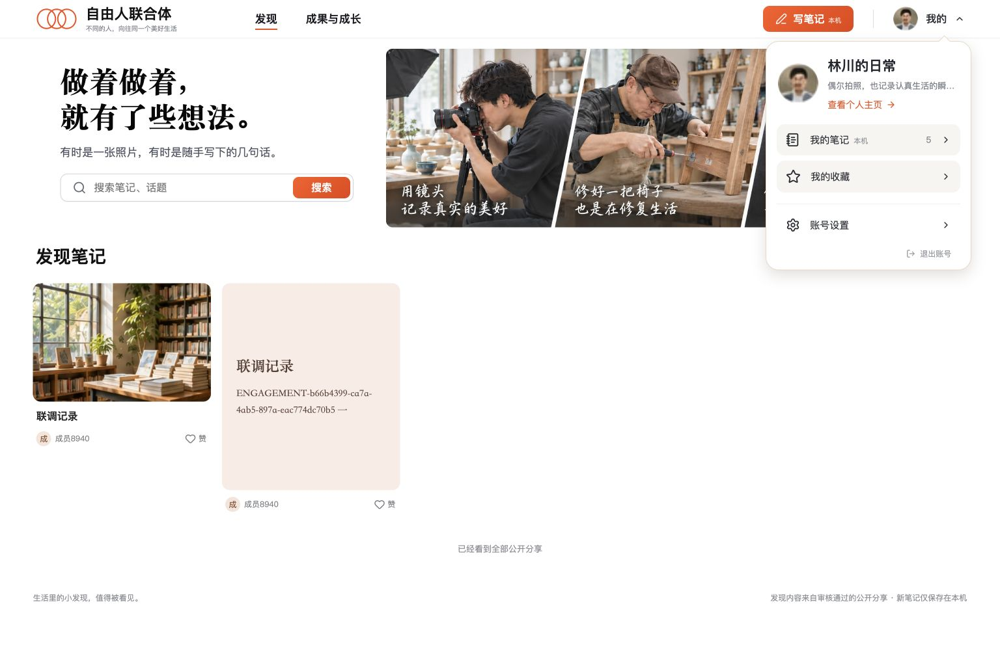
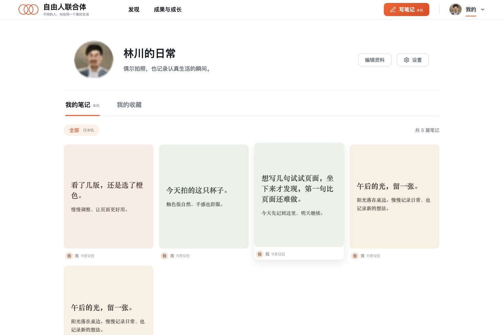
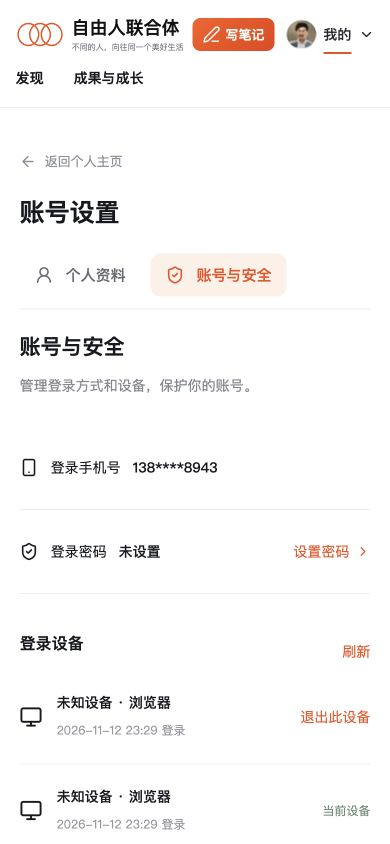
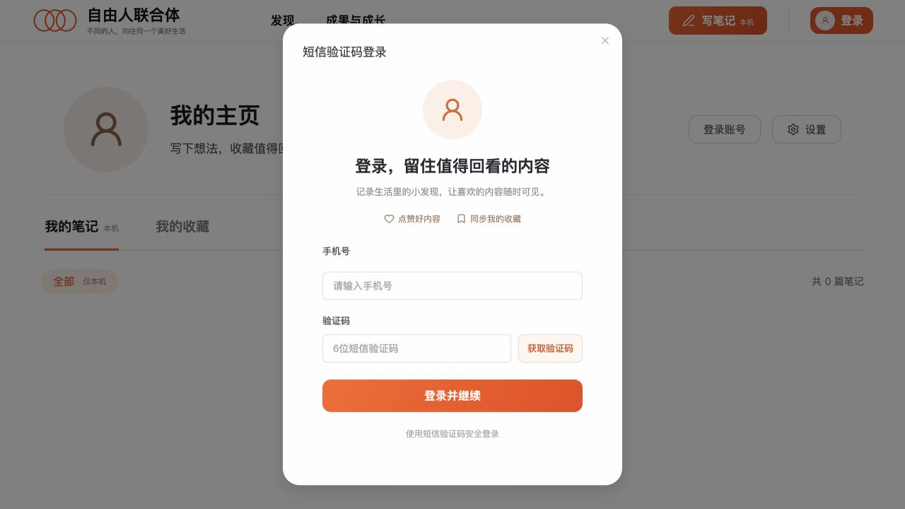
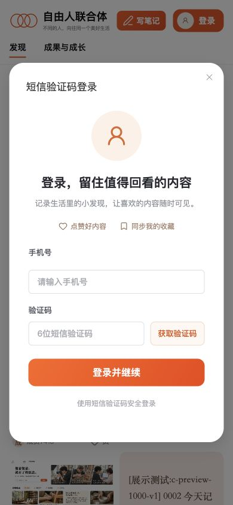
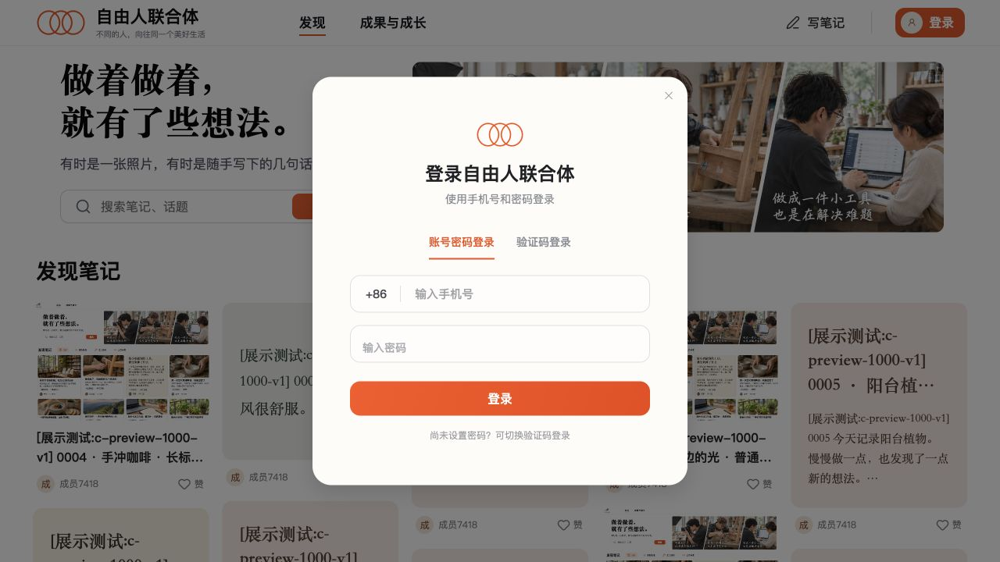
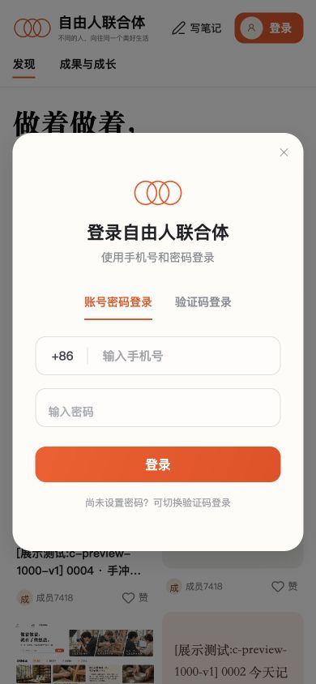

# 个人主页与设置验证

日期：2026-11-12。实现入口：`/?view=mine`、`/?view=favorites`、`/?view=settings`。视觉参考为本轮提供的账号菜单、个人主页两张图片；采用白底、橙色强调、圆形头像、细边框和轻阴影。

## 已实现与数据边界

- 顶栏写笔记在前、分隔线和“我的”在后；账号菜单展示本人资料，支持个人主页、笔记、收藏、设置、登录／退出。点击外部、Escape、方向键与焦点离开可关闭或选择。
- 个人主页大头像、昵称、简介、编辑与设置按钮、笔记／收藏页签。个人页桌面四列、手机两列；发现页保留五列。笔记统计来自当前浏览器的本机内容。
- 编辑资料创建独立副本；昵称与简介校验、上传和移除头像、取消、保存反馈。头像采用现有上传凭证 → 云直传 → 完成确认 → 保存资料绑定；未保存的头像不会替换当前资料。限制 JPG／PNG／WebP、5MB。
- 设置页个人资料与账号安全分区，手机号脱敏、密码状态、验证码设置／重置密码、登录设备列表、撤销其他设备及退出当前账号。危险写入期间防止重复提交，密码提交期间禁用遮罩／Escape关闭。密码成功后重新恢复会话并要求登录。
- 远端资料、密码状态、设备进入 Vue Query，按当前账号编号隔离并在身份切换时取消旧查询、移除私有缓存；账号仍归 Pinia。昵称保存成功更新顶栏并失效公开作者查询。本机笔记与这些状态独立。

所有账号接口复用后端 `users/me`、`users/profile/save`、`users/avatar/*`、`users/sessions`、`users/sessions/revoke`、`users/password/status`、`auth/sms/send`、`auth/password/set`／`reset`；GET／POST、编号 Query 参数和 Cookie 身份按既有契约。无需修改 B 端接口或 DTO，也没有以后台本人时间线替代 C 端笔记契约。

## 与参考图的核对

1. 顶栏顺序、橙色按钮与头像菜单位置一致；手机导航换行。
2. 菜单采用圆角白面板、淡灰快捷项、资料区和分隔线；昵称、简介过长截断。
3. 个人页保留大头像、姓名／简介层级、右侧操作和留白；手机操作移至下一行。
4. 橙色页签下划线、内容统计、桌面四列与手机两列对应参考图。
5. 设置和表单延续相同圆角、细边框、橙色交互状态；390px 宽度无横向溢出。

有意保留的差异：我的笔记标明“本机”，不添加尚未实现的公开／私密筛选；收藏接口没有总数，菜单不造数；头像及卡片使用真实资料和本机内容，不硬编码参考图中的人物与笔记。参考图中的推荐栏、分类不属于本轮账号页面范围。

## 验证结果

- `npm run check`：类型、lint、8 个测试文件 27 项测试、生产构建通过。构建仍提示现有主包大于 500kB，未为本次样式调整额外重构构建配置。
- 服务边界新增 3 项测试：Cookie 身份与 AbortSignal、明确清空资料字段、无效协议与401、短信用途和设备编号编码、头像 MIME／大小校验及上传确认顺序；上传云端不携带 Cookie，失败不确认绑定。
- 浏览器采用当前可用的 CUA 浏览器接口，未用独立 Playwright 进程接管浏览器。复用用户的 5175 前端服务；通过临时同源代理连接独立 Testcontainers MySQL／Spring Boot，未重启用户管理的服务或写入开发库。
- 浏览器实际完成：编辑昵称／简介 → 保存 → 刷新回显；取消修改不生效；我的笔记保存、数量变更与五张卡片换行；收藏页读取真实收藏；菜单跳转和 Escape；设置读取密码状态、设备列表；确认退出其他设备后该行消失；退出本人后私人资料清空、显示登录入口。
- 密码弹窗检查打开、取消与空表单验证码错误提示；没有在浏览器输入新密码或发送真实短信。密码成功链路未在本轮浏览器端到端实测。
- 桌面1536×1024与手机390×844检查菜单、个人页、资料弹窗、个人资料和安全设置，页面宽度无溢出；浏览器检查期间未发现 console error／warn。
- 隔离数据头像权限与绑定使用真实接口，云端图片字节使用现有本机图片替身；本轮没有对真实云存储上传做浏览器验证。不能据此声称真实云环境上传已通过。
- 第一轮隔离浏览器联调：数据库回读昵称／简介断言与 Maven 目标测试通过。第二轮先验证退出账号，随后临时脚本仍使用已撤销Cookie读取本人资料，导致测试脚本断言失败；这是测试收尾顺序错误，实际退出行为符合预期。临时代理和后端测试注入已清理，恢复原测试后单独复验 `ShareIntegrationTest#consumerEngagementsAreIdempotentIsolatedAndPublicOnly`：1 项通过，0 失败。

## 页面截图

以下截图使用隔离账号和测试内容：

## 未登录入口与弹窗（2026-11-14）

借鉴用户提供的抖音未登录参考图，保留本站白底橙色：未登录显示头像＋登录按钮，菜单标记“未登录”；已登录只显示头像。没有新增浏览历史、稍后再看等尚未实现入口。短信弹窗使用圆角、居中头像与说明、手机号和验证码、主操作按钮；不模拟一键登录，也不添加没有实际页面的协议链接。

沿用真实短信登录接口，加入手机号／6位验证码提交校验、发送冷却60秒和重复提交保护，卸载清理定时器，不显示开发验证码。收藏触发登录并保留原操作，本机笔记直接进入。

验证：复用5175服务，CUA浏览器验证桌面与390×844手机弹窗、菜单、关闭重开、空手机号提示、收藏触发登录及本机笔记免登录；手机无横向溢出。`npm run check`类型、lint、27项测试及构建通过，仍有现有主包大小提示。本轮没有发送短信或输入真实验证码，不声称真实登录成功链路已重新实测。

## 双方式登录与悬停菜单（2026-11-14，当前实现）

按最新参考图调整：鼠标移入登录入口展开菜单，移出延迟160毫秒关闭，移入菜单取消关闭；点击登录按钮或菜单顶部未登录身份区域直接打开登录框。移除独立“登录账号→”行，已登录仍只展示头像。顶栏写笔记改为轻量文字入口，本机归属继续在笔记页面与编辑器内说明。

弹窗使用品牌标记、暖白背景、居中标题及橙色主按钮，默认手机号＋密码，可切换短信验证码。密码通过现有 POST /api/v1/auth/password/login 提交，沿用 Cookie 会话；密码不写入持久存储。切换方式清空密码、验证码与提示，保留手机号。短信沿用原发送和登录接口。

验证：npm run check 通过类型、lint、10个文件29项测试及生产构建。新增密码登录契约／401处理测试与菜单悬停、跨间隙取消关闭、移出关闭、点击登录测试。CUA浏览器检查桌面和390×844手机布局、默认密码方式、切换短信、空手机号校验、菜单身份入口打开弹窗；浏览器未捕获 error／warn。鼠标悬停通过组件事件测试验证，未做真实指针悬停自动化。本轮未提交真实密码或发送短信，真实登录成功链路未重新端到端实测。未变更后端或B端接口，未重启用户服务。

