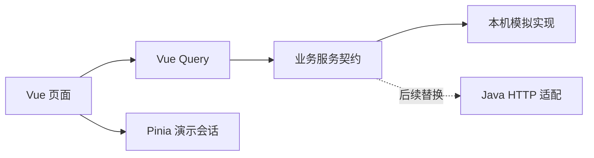

> 2026-10-25 更新：B/C 已统一分类与正式发布版本。原独立公开配置已删除；草稿与正式版本隔离，列表仅含所有人可见任务，受邀详情及媒体由后端验证会话和邀请资格。

# C 端原型架构与接入计划

> 2026-10-25 接入更新：公开分类、首页分页筛选、大厅、任务预览和详情已接真实后端；实现见 `src/services/publicTasks.ts`，默认 api 模式，可显式切换 mock。下文关于本机数据、写操作和演示会话的描述适用于 mock 模式；收藏、意向、发布、选人仍未接入真实接口。

## 当前实现

Vue 3 + TypeScript + Vite，Vue Router 分页路由，Pinia 管理演示身份和登录后续动作，Vue Query 管理异步数据。Element Plus 提供弹层和表单基础能力，独立 CSS 定义橙色品牌及响应式布局。

业务按 discovery、tasks、publishing、publisher、account 分模块；domain 是页面独立的类型层；services/contracts 定义服务能力，services/mock 使用本地数据模拟延迟、权限和业务约束，services/index.ts 负责组装实现。

模拟发布生成项目及一个关联任务；这用于验证页面关系，不能作为正式需求拆解规则。真实 B 端发布不会同步到本原型，本原型也不向 Java 写数据。

## 可评估的页面与交互

| 能力 | 目前 | 后续后端工作 |
| --- | --- | --- |
| 机会大厅 / 项目 / 任务 | 模拟数据、筛选、预览、详情 | 公开读模型、分页、搜索、上下架 |
| 登录与收藏 | 演示身份、账号隔离的本机收藏 | 正式认证、幂等收藏、用户收藏列表 |
| 表达意向 | 校验、登录续操作、防重复 | 提交接口、状态、权限及唯一约束 |
| 我的意向 | 保留入口 | 撤回、修改、拒绝重投等规则待定 |
| C 端发布 | 本机草稿、三步发布、预览 | 需求与项目任务映射、审核与发布权限 |
| 选择承接人 | 演示选择与人数上限 | 并发容量校验、选择记录和状态同步 |
| 报酬 | 仅展示 | 暂不接支付 |
| 沟通、交付、验收 | 说明或入口 | 后续评论、飞书群跳转、履约规则 |

## API 接入顺序

1. 与共享 Java 后端确认公开项目/任务 DTO 和 B 端发布映射；避免把内部需求树直接暴露给 C 端。
2. 先实现只读大厅与详情，再接正式登录、收藏、意向提交。
3. 接 C 端需求创建、发布者工作台、承接人选择；权限和人数限制必须由后端负责。
4. 根据评估补充我的意向、评论、飞书群与交付链路。

当前未约定业务接口 URL。接入时新增 HTTP service，将 DTO 映射到 domain；页面继续通过业务服务调用，不直接 fetch。但 favorites、hasInterest 等同步方法需要改成异步查询，同时调整契约、页面调用与缓存，不能只替换服务文件。跨平台可复用契约、类型和部分规则，Web DOM/CSS 不承诺直接复用为 uni-app x 原生页面。

生产构建有组件库全量注册的体积提示；部署前可改为组件按需加载。当前是供产品评估的交互原型，localStorage 不是权限安全边界。

工程实现遵循[前端架构](前端架构.md)、[接口与状态管理规范](接口与状态管理规范.md)及[测试规范](测试规范.md)。首页“附近”目前以样例城市杭州筛选，不包含真实定位；推荐和成果样例也不代表个性化算法或履约系统已实现。
